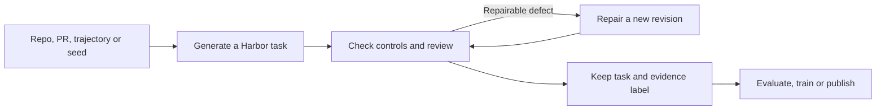

<h1 align="center">Repo2RLEnv</h1>

<p align="center">
  <b>Build verifiable RL environments for coding agents.</b>
</p>

<p align="center">
  <a href="https://pypi.org/project/repo2rlenv/"></a>
  <a href="https://pypi.org/project/repo2rlenv/"></a>
  <a href="https://github.com/huggingface/Repo2RLEnv/actions/workflows/ci.yml"></a>
  <a href="https://huggingface.github.io/Repo2RLEnv/"></a>
  <a href="https://huggingface.co/collections/FineEnvs/repo2rlenv-verifiable-rl-environments-6aa82300d7494c050f50508d"></a>
  <a href="https://harborframework.com/"></a>
  <a href="https://github.com/huggingface/Repo2RLEnv/blob/main/THIRD_PARTY_NOTICES.md"></a>
</p>

<p align="center">
  <a href="https://huggingface.github.io/Repo2RLEnv/">Documentation</a> ·
  <a href="#quickstart">Quickstart</a> ·
  <a href="#what-you-can-build">Pipelines</a> ·
  <a href="#datasets">Datasets</a> ·
  <a href="https://huggingface.github.io/Repo2RLEnv/release_notes/HISTORY/">Changelog</a>
</p>

<p align="center">
  
</p>

Repo2RLEnv turns repositories, pull requests, agent trajectories and task seeds into
[Harbor](https://github.com/harbor-framework/harbor) tasks. Each task includes an
instruction, a starting environment, a verifier and a reference solution.
Repo2RLEnv generates and reviews the tasks; Harbor runs agents against them.



## Quickstart

**Python 3.12+ and the [GitHub CLI](https://cli.github.com) are required.** This
example generates patch-similarity tasks without Docker or model calls:

```bash
pip install repo2rlenv
gh auth login

repo2rlenv generate --repo pallets/click --pipeline pr_diff \
  --pipeline-opt limit=3 --out ./tasks
repo2rlenv validate ./tasks --oracle
```

`limit` caps candidates, so this may export fewer than three tasks. `validate` is a
file check; it does not run the environment.

To execute these tasks, install the tested Harbor integration and start Docker.
Set `ANTHROPIC_API_KEY` in your shell: **PR-diff grading requires a model judge**,
including when checking the reference solution.

```bash
pip install 'repo2rlenv[harbor]'
harbor run -p ./tasks -a oracle --env docker \
  --ve ANTHROPIC_API_KEY="$ANTHROPIC_API_KEY"
harbor run -p ./tasks -a nop --env docker \
  --ve ANTHROPIC_API_KEY="$ANTHROPIC_API_KEY"
```

An unavailable judge leaves the trial **ungraded**, not a zero reward. For
test-based rewards, choose `pr_runtime` or Tasksmith instead.
[Continue the quickstart →](https://huggingface.github.io/Repo2RLEnv/quickstart/)

## What you can build

| Start with | Use | What the agent does |
|---|---|---|
| Merged PRs; no test execution during generation | [`pr_diff`](https://huggingface.github.io/Repo2RLEnv/pipelines/pr_diff/) | Reproduce a change, scored by patch similarity and a correctness judge |
| PRs or commits with runnable tests | [`pr_runtime`](https://huggingface.github.io/Repo2RLEnv/pipelines/pr_runtime/), [`commit_runtime`](https://huggingface.github.io/Repo2RLEnv/pipelines/commit_runtime/), [`cve_patches`](https://huggingface.github.io/Repo2RLEnv/pipelines/cve_patches/) | Fix failing tests while preserving passing tests |
| A merged Python PR needing custom task design | [Tasksmith](https://huggingface.github.io/Repo2RLEnv/pipelines/tasksmith/) | Implement the requested behavior, checked by private tests |
| Repository functions or APIs | [`code_instruct`](https://huggingface.github.io/Repo2RLEnv/pipelines/code_instruct/), [`equivalence_tests`](https://huggingface.github.io/Repo2RLEnv/pipelines/equivalence_tests/) | Implement functionality against generated or differential tests |
| Recorded coding-agent sessions | [`trajectory_to_env`](https://huggingface.github.io/Repo2RLEnv/pipelines/trajectory_to_env/) | Repair, build, extend or answer a data question derived from the session |
| Repositories, seeds, terminal recordings or existing tasks | [Research recipes](https://huggingface.github.io/Repo2RLEnv/pipelines/owned_recipes/) | Repository repair, reconstruction, terminal work, reasoning or optimization |

The recipes include **SWE-smith, SWE-gen, SWE-Next, R2E, R2E-Gym, SWE-Flow,
CodeMidas, SETA Seed2Synth, SETA Evol, TMax, Endless Terminals, TerminalWorld,
CLI-Gym, DataArc, SCALER and FrontierSmith**. Their implementation lives in this
repository, with [upstream credits and retained licenses](THIRD_PARTY_NOTICES.md).

```bash
repo2rlenv pipelines list
repo2rlenv pipelines describe repo_mutate --recipe swe_smith
```

Native generation uses local Docker when it executes code. Tasksmith and research
recipes execute target code on **Modal or Daytona** workers; supported GPU trials
use Modal. [Choose a pipeline](https://huggingface.github.io/Repo2RLEnv/choose-a-pipeline/)
compares inputs, rewards and requirements.

## Tasksmith: an agent that builds environments

Tasksmith uses **LangGraph with Pi or OpenCode** to investigate a merged PR,
build its dependencies, design a human-readable task and verifier, and check the
reference against the starting code. Review, verifier probes and a blind rollout
then guide bounded repairs. Failed or incomplete attempts retain their diagnoses.

Start with the [one-PR walkthrough](https://huggingface.github.io/Repo2RLEnv/pipelines/tasksmith/#run-one-pr),
then use [batch campaigns](https://huggingface.github.io/Repo2RLEnv/pipelines/tasksmith_parallel_campaigns/)
to share bootstrap work and control spending.

## Check task quality

A generated task is not automatically suitable for training. Check that the
reference works, the baseline fails as expected, and the verifier measures the
instruction. The shared [quality loop](https://huggingface.github.io/Repo2RLEnv/pipelines/quality_loop/)
can review files and rollouts, probe the verifier and repair supported offline tasks.
The optional [evidence reviewer](https://huggingface.github.io/Repo2RLEnv/pipelines/evidence_review/)
records findings with source excerpts and proposed repairs.

Tasks carry uniform labels: `unverified`, `verified`, `needs_repair` or `blocked`.
Labels describe retained evidence for that task revision; solver success is a
separate measurement. [Quality and verification →](https://huggingface.github.io/Repo2RLEnv/concepts/quality/)

## Datasets

Browse the [FineEnvs collection](https://huggingface.co/collections/FineEnvs/repo2rlenv-verifiable-rl-environments-6aa82300d7494c050f50508d)
or [Harbor Visualizer](https://huggingface.co/spaces/HuggingFaceH4/harbor-visualiser).
The [release inventory](https://huggingface.github.io/Repo2RLEnv/pipelines/releases/)
records dataset revisions, counts and validation scope. The
[yield and cost report](https://huggingface.github.io/Repo2RLEnv/pipelines/economics/)
separates generation, quality review and solver costs.

**[HF_ML_Tasksmith](https://huggingface.co/datasets/FineEnvs/HF_ML_Tasksmith)** contains
50 tasks from Accelerate, Diffusers, PEFT, Transformers and TRL, labeled verified
under the campaign's recorded checks. Other collections include unverified tasks.
Older published artifacts do not automatically receive new generator or verifier fixes.

```bash
hf download FineEnvs/HF_ML_Tasksmith tasks.tar.gz --repo-type dataset --local-dir ./hf-ml-tasksmith
tar -xzf ./hf-ml-tasksmith/tasks.tar.gz -C ./hf-ml-tasksmith
repo2rlenv tasks list ./hf-ml-tasksmith/tasks
```

## Documentation

- [Install](https://huggingface.github.io/Repo2RLEnv/installation/) and [choose a pipeline](https://huggingface.github.io/Repo2RLEnv/choose-a-pipeline/).
- [How it works](https://huggingface.github.io/Repo2RLEnv/concepts/how-it-works/): stages, execution and evidence.
- [Pipeline catalog](https://huggingface.github.io/Repo2RLEnv/pipelines/) and [exact prompts](https://huggingface.github.io/Repo2RLEnv/pipelines/prompt_reference/).
- [Run with Harbor](https://huggingface.github.io/Repo2RLEnv/guides/run-with-harbor/), [remote workers](https://huggingface.github.io/Repo2RLEnv/guides/remote-execution/) and [publishing](https://huggingface.github.io/Repo2RLEnv/guides/publishing/).
- [CLI reference](https://huggingface.github.io/Repo2RLEnv/reference/cli/), [design RFCs](https://huggingface.github.io/Repo2RLEnv/rfcs/) and [release history](https://huggingface.github.io/Repo2RLEnv/release_notes/HISTORY/).

Docs describe current `main`; PyPI installs the latest published release. Use the
[checkout installation](https://huggingface.github.io/Repo2RLEnv/installation/#from-a-checkout)
for unreleased changes. A text index is available at
[`llms.txt`](https://huggingface.github.io/Repo2RLEnv/llms.txt).

## Contributing

Read [CONTRIBUTING.md](CONTRIBUTING.md). For a new generator, open an issue and
start with an [RFC](https://huggingface.github.io/Repo2RLEnv/rfcs/) and the
[pipeline contribution guide](https://huggingface.github.io/Repo2RLEnv/contributing/ADDING_A_PIPELINE/).

## License and credits

Repo2RLEnv's own code is [Apache-2.0](LICENSE). Bundled adaptations retain MIT
and Apache-2.0 terms, so the distribution is `Apache-2.0 AND MIT`.
[Third-party notices](THIRD_PARTY_NOTICES.md) document each source and attribution.
Generated tasks and source repositories retain their own license terms.
