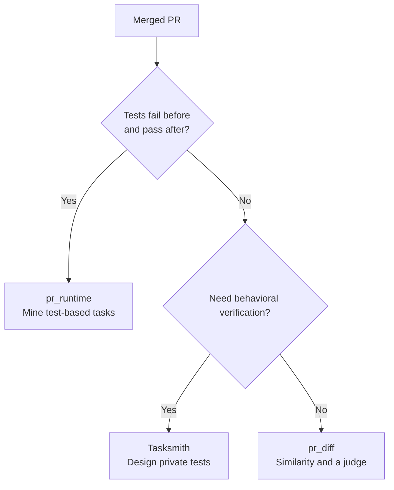

Start with the **input you have** and the **behavior you want to reward**.
`repo2rlenv pipelines list` shows the available native pipelines and recipes;
Tasksmith has its own command group.

## Four questions

1. **What is the input?** PRs, commits, functions, advisories, agent sessions or task seeds?
2. **What proves success?** Passing tests, reaching a shell state, matching an answer or improving an objective?
3. **Where can target code run?** Local Docker for native execution; Modal or Daytona for recipes and Tasksmith.
4. **What evidence do you need?** A generated example, a task with passing controls or a reviewed evaluation set?

For merged PRs, use this decision path:

## Compare the routes

| Route | Input → task | Reward | Generation requirements |
|---|---|---|---|
| [PR diff](pipelines/pr_diff.md) | Merged PR → reproduce its change | Similarity plus required correctness judge | GitHub/GitLab access; no Docker or LLM during generation |
| [PR runtime](pipelines/pr_runtime.md) | PR with tests → repair source | Fail-to-pass × pass-to-pass rate | Local Docker; bootstrap model unless reusing a build |
| [Commit runtime](pipelines/commit_runtime.md) | Commit with tests → repair source | Same test contrast | Local Docker; bootstrap and instruction model |
| [CVE patches](pipelines/cve_patches.md) | OSV advisory and fix → vulnerability repair | Same test contrast | GitHub, Python, Docker; bootstrap and optional test authoring |
| [Code instruct](pipelines/code_instruct.md) | Python API → implement a generated request | Hidden tests | Docker and model-authored problem, tests and solution |
| [Equivalence tests](pipelines/equivalence_tests.md) | Python function → reimplement its behavior | Differential tests | Docker and generated tests |
| [Trajectory to environment](pipelines/trajectory_to_env.md) | Agent session → repair, build, extend or QA | Check, test fraction or exact answer | Local Docker; model calls for build, extend and QA |
| [Tasksmith](pipelines/tasksmith.md) | Merged Python PR → custom behavioral task | Private tests | Remote worker, Pi/OpenCode author and review models |
| [Research recipes](pipelines/owned_recipes.md) | Recipe-specific source → repair, terminal or reasoning task | Recipe-specific deterministic verifier | Remote worker; most recipes also need a model |

`pr_diff`, `pr_runtime` and `commit_runtime` are marked stable. The other routes
are experimental. These are implementation statuses, not quality ratings for
individual tasks. [Rewards](concepts/rewards.mdx) defines each score.

## If you want…

| Goal | Good starting point |
|---|---|
| Learn the task format without building an image | [PR-diff quickstart](quickstart.mdx) |
| Mine existing regression tests | [PR runtime](pipelines/pr_runtime.md) or [commit runtime](pipelines/commit_runtime.md) |
| Design a task when a PR's own tests are insufficient | [Tasksmith](pipelines/tasksmith.md) |
| Create repair tasks from a healthy repository | [SWE-smith](pipelines/repo_mutate.md) |
| Reconstruct removed functions or features | [R2E](pipelines/r2e.md), [SWE-Flow](pipelines/repo_reconstruct.md), [CodeMidas](pipelines/codemidas.md) |
| Create terminal tasks | [SETA Seed2Synth](pipelines/terminal_synth.md), [TMax](pipelines/tmax.md), [Endless Terminals](pipelines/endless_terminals.md) |
| Reuse recordings or existing tasks | [TerminalWorld](pipelines/terminalworld.md), [SETA Evol](pipelines/task_evolve.md), [DataArc](pipelines/dataarc.md) |
| Repair broken development environments | [CLI-Gym](pipelines/env_repair.md) |
| Generate reasoning or optimization tasks | [SCALER](pipelines/scaler.md) or [FrontierSmith](pipelines/frontiersmith.md) |

The [recipe guide](pipelines/owned_recipes.md) maps every method to its pipeline
family, input format and example configuration. Recipes are owned implementations
with documented differences from the cited research.

## Run your choice

| Route | Entry point |
|---|---|
| Native repository pipeline | `repo2rlenv generate --repo org/service --pipeline NAME --out ./tasks` |
| Trajectory pipeline | `repo2rlenv generate --config examples/trajectory-to-env.yaml` |
| Research recipe | `repo2rlenv generate --config examples/owned-swe-smith.yaml` after [worker setup](guides/remote-execution.mdx) |
| Tasksmith | Follow [Run one PR](pipelines/tasksmith.md#run-one-pr) to supply a panel, campaign and runtime wheel |

Native pipelines that bootstrap or author with a model also need `--llm
provider/model` or an `llm` block. Trajectory repair has no authoring model call.
Use `repo2rlenv pipelines describe repo_mutate --recipe swe_smith` to inspect a
recipe's input and provenance without starting a paid run.

## Known limits

- **Candidate limits are not output targets.** Unsupported changes, failed builds
  and missing test contrast reduce yield. Tasksmith also has bounded attempts;
  it cannot guarantee one accepted task per PR.
- **Language coverage varies.** Diff tasks are language-independent. Native
  bootstrap supports several toolchains; synthesis pipelines and Tasksmith have
  narrower source requirements. Check the route's guide.
- **Recipe and Tasksmith execution is remote.** Their controllers need Linux,
  macOS or WSL. Supported GPU trials require Modal.
- **Generated and verified are different.** Check each task's
  [evaluation label](pipelines/task_evaluation_labels.md) and retained evidence.
- **SEC-bench is deferred.** It is listed as planned and is not implemented.
