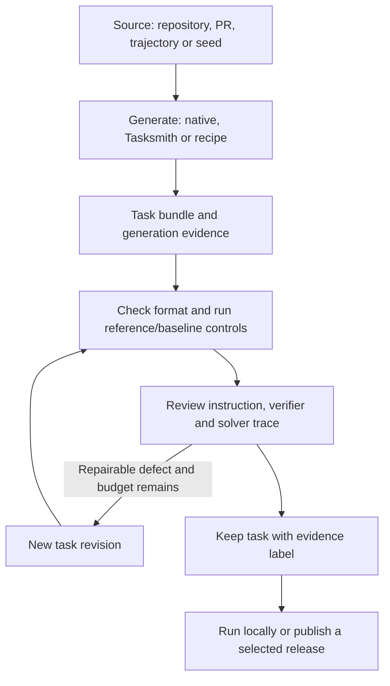

Every route produces the same kind of artifact: a [Harbor task](tasks.mdx).
The generation method determines its starting state, instruction, verifier and
reference solution. Later checks determine what you can claim about its quality.

A failed or incomplete review can leave a task available for diagnosis. Export,
control success, quality acceptance and solver success are separate outcomes.

## Generation

| Route | What happens | Entry point |
|---|---|---|
| Native pipelines | Mine existing changes or author tasks against source code; trajectory generation replays recorded sessions | `repo2rlenv generate` |
| Tasksmith | Investigate a merged PR, bootstrap its dependencies, design private behavioral tests, construct and review the task | `repo2rlenv tasksmith run` |
| Research recipes | Apply a specific published method through an in-repo implementation | `repo2rlenv generate --config FILE` with a recipe |

Repository-based runtime pipelines use the shared [bootstrap](../reference/BOOTSTRAP.md)
to prepare a reusable image. Trajectory generation has its own image-building
lifecycle. Tasksmith can reuse dependency layers while checking each PR's pinned
revision. [Choose a pipeline](../choose-a-pipeline.mdx) explains which route fits
which input.

### Where prompts enter

Model calls author instructions, tests or task designs, interpret evidence and
propose repairs. Builds, test execution, schema checks and budget accounting are
code. A stage named “reviewer” does not necessarily use a different model.

Each pipeline guide maps its model calls to inputs, outputs and retry limits.
[Prompt stages](../pipelines/prompt_reference.md) links to the exact templates and
request assembly. Saved request receipts show the concrete source and failure
feedback sent during a particular run; keep those private from the learner.

## Where code runs

### Native pipelines run locally

Native generation runs on the controller. When it executes target code, it uses
Docker. `pr_diff` only mines and packages during generation; its judge is called
later during grading. Trajectory tasks use Docker directly rather than the
shared repository bootstrap.

### Recipes, Tasksmith and the quality loop use a controller and a worker

| Controller | Remote worker |
|---|---|
| Validate configuration and track budgets | Clone targets and build images |
| Dispatch model requests and retain receipts | Execute target code and generated tests |
| Assemble artifacts and bind evidence to hashes | Run controls, verifier probes and solver trials |

CPU execution uses Modal or Daytona. Supported GPU trials use native Modal L4
sandboxes. These routes have no local execution fallback.

A [campaign](glossary.mdx#campaign) holds the ledger and receipts. Operations
reserve budget before dispatch; uncertain outcomes retain their reservations
until reconciled. The limit controls dispatch, not the provider's invoice.
[Remote execution](../guides/remote-execution.mdx) covers setup, reuse and cleanup.

## Verification

| Check | What it establishes | What it does not establish |
|---|---|---|
| Static format check | Required files and metadata exist | The image builds or the task is solvable |
| Reference and baseline controls | The expected contrast in this environment | Complete coverage or resistance to reward hacks |
| Review and verifier probes | Evidence for instruction quality, coverage, alternatives and leakage | An exhaustive proof of verifier correctness |
| Blind solver rollout | How one model attempted this exact task | General difficulty or task quality by itself |

`repo2rlenv validate --deep --oracle` checks the legacy native task layout. Schema
1.2/1.3 bundles need Harbor's parser and execution controls; do not treat the
legacy validator's schema error as a failed task. See [quality](quality.mdx) for
commands and the remote review loop's supported task shapes.

## Publishing

| Command | Use |
|---|---|
| `repo2rlenv push DIR org/name` | Publish native output, including distribution of bootstrap images |
| `repo2rlenv release stage`, `verify`, `publish` | Publish an explicit, hash-bound selection of recipe or Tasksmith bundles |
| `repo2rlenv pull org/name[@rev]` | Download a dataset using the Hub bridge |

For an exact copy of a recipe or Tasksmith release, use its `tasks.tar.gz`
archive as shown on the dataset card. Keep evidence and labels bound to the same
revision. [Publishing](../guides/publishing.mdx) explains the two publication paths.

## Consumption

Harbor runs the reference, a no-op agent or a learner against the task. Its trial
results contain rewards, errors and trajectories. For RL, consume scored results
and distinguish ungraded failures from zero rewards. For evaluation, report the
controls, task revision, model and runtime with the score.

Continue with [Run with Harbor](../guides/run-with-harbor.mdx), [Rewards](rewards.mdx)
and [Quality and verification](quality.mdx).
