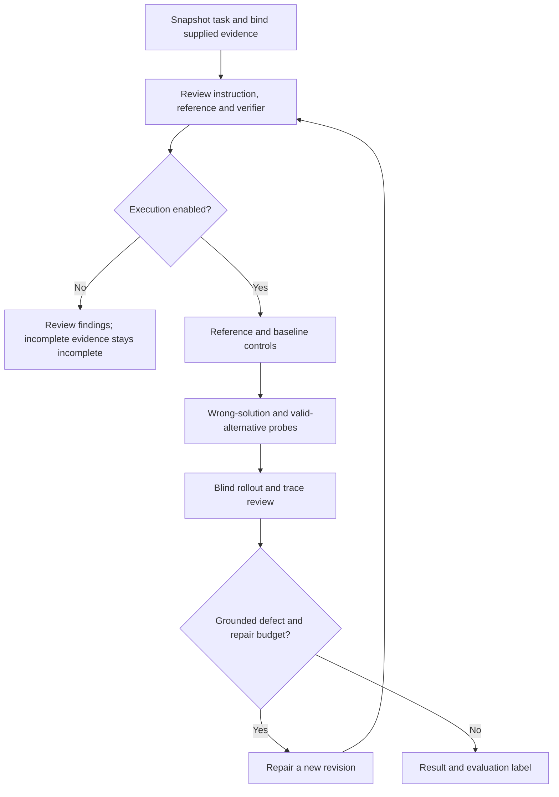

**A generated task is not automatically a good RL task.** Check whether the request
is clear, the reference solves it, and the verifier accepts valid solutions while
rejecting wrong ones. Solver success is a separate question: a good task may be hard.

## Generated vs verified

| Evidence | What you know |
|---|---|
| Exported task | The generator reached its export conditions; some routes permit partial or unchecked output |
| Static validation | The expected files and metadata are present |
| Reference/baseline controls | The known solution and untouched task produce the expected contrast |
| Quality result | A named review profile checked the bundle using the retained evidence |
| Blind solver result | One model's outcome on that task revision |

The published [release inventory](../pipelines/releases.md) reports these scopes
separately. Historical labels do not certify a dataset against later verifier fixes.

## Controls

### Static validation

For legacy native tasks containing `version` and `[task]`:

```bash
repo2rlenv validate ./tasks --deep
repo2rlenv validate ./tasks --oracle
```

`--oracle` adds checks for reference assets; it does not execute them. The CLI's
legacy validator does not accept all newer `schema_version` bundles, including
recipe, Tasksmith and trajectory output. Use Harbor parsing and controls for those
bundles; [release staging](../pipelines/dataset_release.md) also parses selected tasks.

### Nop and oracle runs

For binary test tasks, expect an untouched task to score 0 and the reference to score 1:

```bash
harbor run -p ./tasks -a nop --env docker
harbor run -p ./tasks -a oracle --env docker
```

Check the reward contract before applying those thresholds. SCALER uses −1/+1;
FrontierSmith has a continuous optimization reward; PR-diff includes a model judge
and needs verifier credentials. Missing rewards are ungraded failures, not zeros.
See [Rewards](rewards.mdx) and [Run with Harbor](../guides/run-with-harbor.mdx).

If the controls disagree with their expected outcomes, inspect the environment,
reference and verifier before evaluating a learner. Passing both controls is useful
but can still miss an incomplete or exploitable verifier.

## Review and repair

`repo2rlenv quality run` takes a Harbor task and optional existing trial evidence.
It keeps the original intact and writes repairs as new revisions.



| Mode | What it does |
|---|---|
| Review only | Metered model calls and bounded reads; no task execution |
| `--run-rollout` | Run missing controls, verifier probes and a blind solver remotely |
| `--repair` | Enable bounded edits and execution checks for each repaired revision |

The default profile, `practical-generation-v1`, assesses the task, verifier and
leakage. Optional `evidence-review-v2` adds seven criteria with cited findings:
alignment, feasibility, reference, coverage, alternatives, gaming and leakage.
Both retain their evidence and cannot override failed execution controls with
an optimistic model rating. [Reviewer evaluation](../pipelines/evidence_review.md)
explains the experimental profile and benchmark.

Start with a review-only run; the amounts below are spending limits, not estimates:

```bash
repo2rlenv campaign init workspace/review --budget-usd 10
repo2rlenv quality run ./tasks/example \
  --campaign workspace/review --out workspace/review/example \
  --profile evidence-review-v2 --max-probes 0 --max-spend-usd 2
repo2rlenv quality show workspace/review/example
```

To execute or repair, follow [the full loop guide](../pipelines/quality_loop.md#use-it)
and [remote setup](../guides/remote-execution.mdx). CPU trials need a matching
runtime wheel and a Modal or Daytona worker. GPU trials have a separate Modal route.

| Result status | Meaning |
|---|---|
| `usable` | Review, expected control/probe outcomes and legitimate rollout evidence satisfy the profile |
| `reviewed` | Review completed, but execution evidence is incomplete or unresolved |
| `needs_repair` | Concrete task or verifier defects remain |
| `needs_evidence` | Evidence, parsing or execution needs diagnosis |
| `budget_exhausted` | The next paid step exceeded the available allowance |

**Check `status == "usable"` for full acceptance.** Exit 0 also covers `reviewed`.
Neither disposition means a learner must solve the task. The
[loop guide](../pipelines/quality_loop.md) documents evidence reuse, models, retries
and repair restrictions; the [prompt guide](../pipelines/prompt_reference.md) links
to the actual requests.

## Evaluation labels

Labels live under `[metadata.repo2env.evaluation]` in `task.toml`:

| Label | Meaning |
|---|---|
| `unverified` | Generated or partially checked; decisive evidence is missing |
| `verified` | A saved quality result and its bound execution evidence satisfy the recorded profile |
| `needs_repair` | A task or verifier defect was found |
| `blocked` | An operational limit prevented completion |

The quality loop writes a labeled copy under `OUT/labeled/`. Importing `verified`
requires matching task hashes, controls, probes, rollout review and trial-file
digests; it cannot be assigned with a manual `--status verified` flag.

```bash
repo2rlenv tasks list ./tasks
repo2rlenv tasks list ./tasks --status needs_repair
repo2rlenv tasks show ./tasks/example
```

See [evaluation labels](../pipelines/task_evaluation_labels.md) for the full mapping,
manual diagnoses and identity rules. Keep the supporting evidence with a labeled
corpus: reading a label alone does not revalidate its contents.

## Limits

- Remote review execution supports single-container, offline Dockerfile tasks.
  Most native repository tasks need Harbor directly for their execution controls;
  review-only inspection is still available.
- The quality loop uses its own acceptance thresholds. Continuous-reward tasks
  such as [FrontierSmith](../pipelines/frontiersmith.md#task-and-evidence-layout) need
  recipe-specific interpretation rather than an assumed binary pass criterion.
- Probes test selected wrong solutions and alternatives. They cannot prove the
  verifier handles every possible submission.
- Campaign limits bound dispatch. They do not replace provider billing controls.
