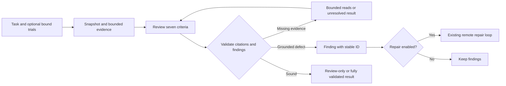
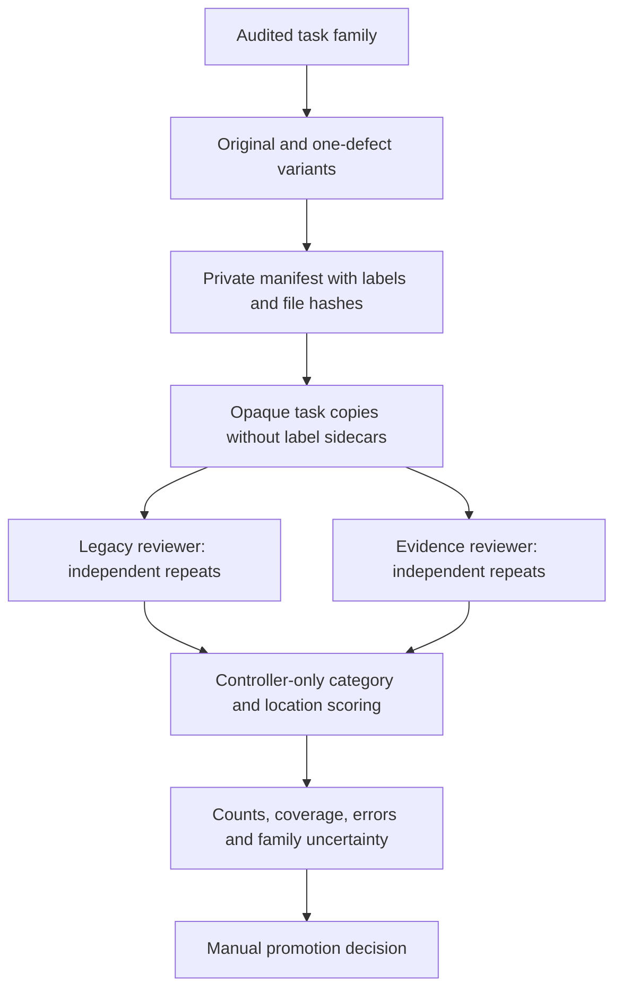

The experimental `evidence-review-v2` profile adds traceable findings to the
[quality loop](quality_loop.md). It reviews the public instruction, private tests,
reference, environment and any supplied rollout. Every finding names a criterion,
source excerpt, grading consequence and proposed repair. Existing deterministic
rewards and the default `practical-generation-v1` reviewer remain unchanged.

This is an independent implementation inspired by micro1's
[Flow-QC article](https://www.micro1.ai/blog/flow-qc), built on Repo2RLEnv's existing
review and repair engine. It does not reproduce micro1's private implementation or
claim their evaluation results. See [RFC 0033](../rfcs/0033-evidence-based-quality-review.md)
for the design, budget assumptions and promotion criteria.

## Review a task

```bash
repo2rlenv campaign init workspace/reviewer --budget-usd 10
repo2rlenv quality run ./tasks/example \
  --profile evidence-review-v2 \
  --campaign workspace/reviewer --out workspace/reviewer/example \
  --review-model anthropic/claude-sonnet-4-6 \
  --max-probes 0 --max-spend-usd 2
repo2rlenv quality show workspace/reviewer/example
```

Review-only mode makes metered model calls and bounded file reads. It does not
execute task code. Pass `--baseline`, `--oracle` and `--rollout` to reuse existing
receipts bound to this task. `--repair` and `--run-rollout` use the existing remote
execution contract: Daytona or Modal for CPU, native Modal for supported GPUs.
Task builds and verifier scripts never run on the local controller.



The seven criteria are **alignment, feasibility, reference, coverage, alternatives,
gaming and leakage**. Rollout interpretation remains a separate decision. A
failed criterion requires a blocking finding; an unknown criterion cannot be
converted into a pass by averaging scores. Solver failure alone is not a task
defect. An observed finding must cite a completed bound trial; static findings
only establish what the inspected source shows. Confidence is low/medium/high,
not a calibrated probability.

A static pass is `reviewed`, not `usable`. Full acceptance still requires the
existing execution controls. Missing material remains `needs_evidence`; a concrete
blocking finding can produce `needs_repair`. Repairs create new revisions and
retain prior evidence.

## What is saved

```text
example/
  result.json                    # v2 result with legacy-compatible assessment fields
  findings.json                  # pointer to the latest accepted detailed review
  reviews/r0-before/
    findings.json                # seven criteria, findings and stable issue IDs
    evidence.json                # exact excerpts, inventory hashes and trial bindings
    reviewer.json                # prompt/code hashes, model and settings
    investigation.json           # supported, dismissed and unresolved hypotheses
  calls/                         # metered requests, responses and usage receipts
  revisions/                     # task snapshots and any repaired revisions
```

Review keys depend on the execution stage. `quality show --json` returns the
versioned result. The `findings.json` pointer locates the richer machine-readable
review. Do not flatten the distinction between final task state and a particular
review: a subsequent repair can change the task hash. Feedback attaches to a
specific immutable review and finding ID.

## Compare reviewer profiles

The benchmark evaluates the **reviewer** by changing task/verifier definitions.
The existing semantic probes evaluate the **verifier** by changing solver
submissions. These are separate experiments.



Prepare a private JSON manifest using
`repo2rlenv.quality.benchmark.models.Manifest`. Each case records:

| Field | Meaning |
| --- | --- |
| `case_id` | Opaque `c-` plus 12 lowercase hexadecimal characters |
| `family`, `lineage` | Shared PR/feature ancestry; all descendants stay together |
| `split` | `development`, `selection` or `final` |
| `task` | Task directory, relative to the manifest or absolute |
| `bundle_hash`, `files` | Executable bundle identity and SHA256 digest of every task file |
| `defect` | `null` for proposed clean cases, otherwise category, location citation and explanation |
| `audit` | Provisional/adjudicated status, named reviewers, rationale and evidence citations |

Use `task_identity(task)` and `inventory(task)` from the quality packages to obtain
the hashes. A defect location must quote an existing file. Validation rejects
changed content, symlinks, root-level non-Harbor sidecars, duplicate case IDs and
families or shared lineage crossing splits. Curators must also inspect task content
for embedded label hints and remove historical acceptance annotations equally
from every variant. A directory allowlist cannot detect every disguised label.

Two recorded reviewers are required for `adjudicated`; this is an audit record,
not identity verification or a substitute for independent inspection. Unresolved
labels stay `provisional`. They receive separate exploratory metrics and do not
enter adjudicated confidence intervals or justify promotion. An unexpected finding
on a purportedly clean case needs adjudication before it is called a false alarm.

Example `reviewer-config.json`:

```json
{
  "review": {
    "review_model": {"provider": "anthropic", "model": "claude-sonnet-4-6"},
    "max_probes": 0,
    "max_read_rounds": 2,
    "model_tokens": 6000,
    "model_reservation_usd": "0.50",
    "max_spend_usd": "2.00"
  },
  "repeats": 2,
  "concurrency": 4
}
```

```bash
repo2rlenv quality benchmark validate workspace/corpus/manifest.json
repo2rlenv quality benchmark run workspace/corpus/manifest.json \
  --split development --config reviewer-config.json \
  --campaign workspace/reviewer --out workspace/reviewer/development
repo2rlenv quality benchmark show workspace/reviewer/development
```

This first benchmark runner compares static task reviews. It does not launch
solvers, repairs or probes, import rollout histories, or escalate to another model.
The ordinary `quality run` command supports those operations. Both profiles use
the same model, read limits and per-session budget; each case/profile/repeat gets
its own request receipts. `--resume` reuses the same session, requires unchanged
configuration and preserves uncertain provider charges. It does not collapse
independent repeats into a cached answer.

Run `selection` after development. `final` additionally requires
`--selection-report workspace/reviewer/selection/report.json`; the report must
match the frozen corpus, reviewer identity and options and have no missing reviews.
Changing code or prompts after selection requires a new selection comparison.
Final-test feedback must not be reused as an untouched holdout.

The report includes detection at the planted **category and location**, blocking
on proposed-clean cases, decision coverage, incomplete reviews and spending.
Category scoring uses the shared legacy categories so both profiles are comparable;
seven-criterion decisions remain in the v2 artifacts. Unknown and failed attempts
remain in denominators. Family bootstrap intervals retain all variants/repeats in
each sampled family. Finding-level precision is explicitly unavailable until
findings have independent adjudication. Reports never automatically promote a profile.

## Dispute or confirm a finding

```bash
repo2rlenv quality feedback record workspace/reviewer/example \
  --issue ISSUE_ID --author maintainer --decision disputed \
  --reason-file reason.txt --out workspace/reviewer/feedback
```

The command prints the saved `feedback.json` path. A feedback record embeds the
original review and exact evidence, with hashes checked when it is read. Repeating
the same feedback is idempotent. It does not edit the task or its evaluation label.

To request a model second opinion, write a **LoopOptions** JSON file (the `review`
object from the benchmark example, without the outer wrapper), then run:

```bash
repo2rlenv quality feedback adjudicate PATH_TO_FEEDBACK_JSON \
  --config adjudicator-config.json --campaign workspace/reviewer \
  --out workspace/reviewer/adjudication
```

The adjudicator returns `upheld`, `overturned` or `unresolved`, with citations and
suggested clean/defective regression cases. Suggestions are not automatically
created, executed or added to the scored corpus. Disagreement is not ground truth;
a model second opinion does not silently change acceptance or benchmark labels.
A maintainer must audit the correction and any new regression pair.

## Prompts and limits

The reviewer combines the existing
[`quality/loop/prompts/review.md`](https://github.com/huggingface/Repo2RLEnv/blob/main/src/repo2rlenv/quality/loop/prompts/review.md)
with `src/repo2rlenv/quality/reviewer/review.md`. The latter defines the seven
criteria, evidence basis, attribution and hypothesis record. Both are pinned in
reviewer identity receipts. The adjudicator prompt lives in
`src/repo2rlenv/quality/feedback.py` as `ADJUDICATE`. The benchmark itself uses no
additional model prompt and never sends its labels or mutation rationales.

Budget caps cover model calls through the existing campaign ledger. Static
benchmark reviews have no cloud execution cost. Remote repair/probe costs belong
to ordinary quality runs. The pilot cap is $150; an observed comparison, rather
than the budget or the number of generated reports, determines readiness. GEPA,
automatic prompt optimization and a default-profile switch are deferred.
