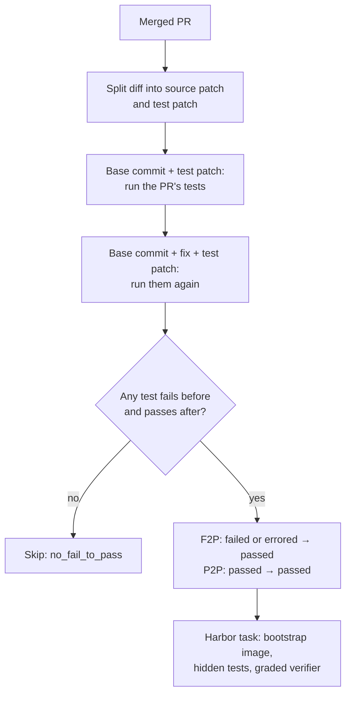

Each task is a merged pull request that fixed a bug and added a test for it. The
agent gets the linked issue and changes the source; the PR's own tests, hidden
until verification, decide the reward. The pipeline runs every candidate's tests
twice in a Docker image built for the repository and keeps a PR only if some tests
fail before the fix and pass after it.

## At a glance

| | |
|---|---|
| Input | A GitHub or GitLab repository with merged PRs that add tests |
| Task | Resolve the issue a merged PR fixed, starting from its base commit |
| Reward | Graded `f2p_rate × p2p_rate`, plus strict `resolved` and `command_resolved` flags |
| Needs an LLM | Yes, for the one-time repository [bootstrap](../concepts/glossary.mdx#bootstrap) (cached) |
| Needs Docker | Yes, for bootstrap, validation and running tasks |
| Hosts | GitHub (needs `gh` on `PATH`) and GitLab |
| Languages | Any repository the bootstrap can build whose tests run under pytest, unittest, Django, `go test`, `cargo test`, `cargo nextest run`, Jest, Mocha or Vitest. The reference dataset has 63 Python and 37 Go tasks |
| Status | Stable |
| Reference dataset | [`FineEnvs/repo2rlenv-pr-runtime`](https://huggingface.co/datasets/FineEnvs/repo2rlenv-pr-runtime): 100 tasks from 13 repositories |

Two test sets define each task ([F2P and P2P](../concepts/glossary.mdx#f2p-and-p2p)). **FAIL_TO_PASS** (F2P) tests fail or error at the
base commit and pass once the fix is applied: they prove the bug existed.
**PASS_TO_PASS** (P2P) tests pass both before and after: they guard against
regressions.

## Quickstart

```bash
repo2rlenv generate \
  --repo pallets/click \
  --pipeline pr_runtime \
  --pipeline-opt limit=20 \
  --pipeline-opt require_linked_issue=true \
  --llm anthropic/claude-sonnet-4-6 \
  --out ./tasks/click-pr-runtime
```

The first run bootstraps the repository: an LLM agent builds a Docker image in
which the test suite runs, capped by `--max-spend-usd` (default 5.0). The image is
cached, so later runs go straight to mining. `limit` counts PRs listed, not tasks
emitted; PRs without a test that flips from failing to passing are skipped, so
expect fewer tasks than `limit`. Each task lands in
`./tasks/click-pr-runtime/pallets__click-<pr>/`. Run the oracle, which should
score 1.0:

```bash
harbor run -p ./tasks/click-pr-runtime -a oracle --env docker
```

Each task's Dockerfile starts `FROM` the local bootstrap image, so tasks run on
the machine that generated them until you publish them with `repo2rlenv push`,
which pushes or inlines the image.

## How it works



1. **Bootstrap** the repository once. An LLM agent iterates in Docker until the
   test suite runs, and records the image and test commands. Results are cached.
   See [Bootstrap](../reference/BOOTSTRAP.md).
2. **List merged PRs**, newest first, exactly as [`pr_diff`](pr_diff.md) does.
3. **Filter on metadata.** Skip drafts, unmerged PRs, PRs with no files, and titles
   that mark chores rather than fixes: backports, cherry-picks, reverts, version
   bumps, releases, changelogs and branch merges or syncs. Optionally require a
   minimum description length (`min_problem_statement_words`).
4. **Split the diff** into a source patch and a test patch by file path. Skip the
   PR if either is empty.
5. **Filter on structure.** Skip PRs whose source changes are all under `.github/`
   (`skip_ci_only`), whose test patch adds no test function or class
   (`require_new_test_funcs`), or that touch more than `max_source_files_per_pr`
   source files. `lite_filter` adds SWE-bench Lite-style constraints.
6. **Validate twice** in one container started from the bootstrap image. Reset to
   the base commit, apply the test patch and run the tests that patch touches; then
   reset, apply the fix and the test patch, and run them again. Keep the PR if at
   least `min_fail_to_pass` tests move from failed or errored to passed.
7. **Write the instruction** from the linked issue (`Fixes #123`, including the
   `[#123](url)` form) when there is one, otherwise from the PR title and
   description. Solution pointers and template sections are stripped.
8. **Emit the task** with the fix as the oracle and the test patch hidden inside
   `tests/test.sh`.

## Options

Pass each option with `--pipeline-opt key=value`.

| Key | Default | What it does |
|---|---|---|
| `pr` | none | Target a single PR by number (`--pr 1234`). Bypasses `limit`/`since`/`until` and the draft/merge-state filters; quality filters still apply |
| `limit` | `50` | Maximum merged PRs to list. You get at most this many tasks |
| `since` / `until` | none | ISO dates (`2026-01-31`) bounding the merge date |
| `skip_drafts` | `true` | Skip draft PRs |
| `require_fail_to_pass` | `true` | Skip PRs with fewer than `min_fail_to_pass` F2P tests after validation |
| `min_fail_to_pass` | `1` | Minimum number of F2P tests |
| `validation_timeout_sec` | `600` | Timeout for each validation test run |
| `skip_validation` | `false` | Emit candidates without running tests. Tasks then have no F2P/P2P lists, a pass/fail exit-code reward and, with nothing measured, a 300 s per-run limit. For debugging |
| `require_new_test_funcs` | `true` | Require the test patch to add at least one test function or class |
| `skip_ci_only` | `true` | Skip PRs whose source changes are all under `.github/` |
| `max_source_files_per_pr` | `50` | Skip PRs that touch more source files than this |
| `min_problem_statement_words` | `0` | Minimum word count of the PR description. `0` disables the check |
| `lite_filter` | `false` | SWE-bench Lite-style sampling: exactly one source file, a description of at least 40 words, and no images, non-GitHub links or commit hashes in it |
| `state` | `merged` | Only `merged` is accepted |
| `require_linked_issue` | `false` | When `true`, skip PRs whose description does not contain a linked issue reference (e.g. `Closes #123`) |
| `languages` | `["python"]` | Accepted but not enforced: the language comes from the bootstrap |

## Output

```files
pallets__click-<pr>
├── task.toml
├── instruction.md
├── environment
│   ├── Dockerfile
│   └── docker-compose.yaml
├── solution
│   ├── patch.diff
│   └── solve.sh
└── tests
    ├── test.sh
    ├── verifier.py
    ├── launcher.py
    ├── grader_tools.py
    ├── f2p.json
    └── p2p.json
```

- `task.toml`: Harbor 1.0 task with `[metadata.repo2env.pr_runtime]` (PR URL, merge time, base commit, F2P and P2P lists, `validation_status`, `flaky_dropped`, `grading_time`, `harbor_min_version`, bootstrap image digest), `reward_calibration` (`f2p_count`, `p2p_count`, `source_files`, `loc_changed`, `difficulty`) and an [evaluation label](task_evaluation_labels.md) that starts as `unverified`.
- `instruction.md`: the issue (or PR) title and description with solution pointers removed.
- `environment/Dockerfile`: `FROM` the bootstrap image, reset to the base commit, with git history past it removed. It keeps a root-only copy of the repository and its dependencies in `/opt/r2e/pristine` for the separate verifier, which adds the size of `/workspace` to the image: measured, +11 MB for more-itertools (276 → 287 MB), +27 MB for a small jest project with its `node_modules` (519 → 546 MB), +1 MB for spf13/cast and about +10 MB for a small cargo crate, whose toolchains and caches live outside `/workspace`. A second Dockerfile for the verifier would avoid this, but `repo2rlenv push` publishes one image per task.
- `environment/docker-compose.yaml`: an egress guard that points PyPI and GitHub hosts (plus `gitlab.com` for GitLab sources) at `0.0.0.0`, so the agent can't download the fixed release or the merged PR. See [contamination defenses](../concepts/tasks.mdx#contamination-defenses).
- `solution/patch.diff`: the PR's source changes only (the [oracle](../concepts/glossary.mdx#oracle)); `solve.sh` applies it.
- `task.toml` sets `[verifier] environment_mode = "separate"` and `artifacts = [{source = "/workspace"}]`: Harbor grades in a fresh container from the task image and copies only the agent's `/workspace` into it. This needs Harbor 0.25.0 or later, whose artifact copy drops absolute and escaping symlinks, setuid bits and special files.
- `tests/test.sh`: rebuilds `/workspace` from the image's copy plus the agent's source diff, resets the PR's test files to the base commit, applies the hidden test patch, runs the targeted test commands as an unprivileged user and calls the verifier.
- `tests/launcher.py`, `tests/grader_tools.py`: the trusted grading steps (standard library only): the test-user launcher and the submission rebuild.
- `tests/verifier.py`: the standalone graded verifier (Python standard library only).
- `tests/f2p.json`, `tests/p2p.json`: the F2P and P2P test names.

## Reward

Python unittest and Django use their verbose `TextTestRunner` output. The pipeline
adds `-v` for unittest and verbosity 2 for Django, and groups subtests under their
parent test with the worst status winning. Both generation and the exported
verifier use the same test identities.

The verifier parses the test log into a status per test and scores:

```text
f2p_rate = F2P tests now passing / F2P tests
p2p_rate = P2P tests still passing / P2P tests   (1.0 when there are none)
reward   = f2p_rate × p2p_rate                    → /logs/verifier/reward.txt
```

The graded reward is the training signal: fixing four of five failing tests
earns 0.8 instead of 0. Two booleans in `/logs/verifier/reward-details.json` are
the evaluation signals:

- **`resolved`**: every F2P and P2P test passes. This is SWE-bench resolution;
  the oracle satisfies it on every task.
- **`command_resolved`**: `resolved`, no failing test outside the F2P and P2P
  sets, and a test command that exits 0. Tasks whose test command also runs
  unrelated failing or flaky tests stay usable for training but miss this flag.

The details file also records per-set totals and rates, `regressions`,
`untracked_failed_count`, the first 20 `untracked_failed` names, `runner`,
`tests_parsed`, `exit_code` and `parse_status`. The published manifest adds
`eval_grade` (`command_resolved` and a non-empty P2P set); filter on it for a
benchmark-grade subset.

### Grading in a separate verifier

Harbor runs the verifier in a fresh container from the task image and copies the
agent's `/workspace` into it. That copy is data, not an environment: `test.sh`
(root, the image's `python3` with `-B -I -S`, a fixed `PATH`) reads from it only what
could be source, turns that into a diff and applies the diff to a fresh copy of
the image's untouched repository in `/opt/r2e/pristine`. Each file is compared
with the image's checked-out copy, not with git's stored blob, so a repository
whose checkout differs from its blobs (`*.bat text eol=crlf`, `ident`) still
applies. Paths the base's ignore rules ignore, dependency and cache directories
(`.venv`, `node_modules`, `__pycache__`, …) and paths the image ships outside
version control are never read, so the agent's virtualenv, shims and installed
packages never reach grading. Harbor still transfers the agent's whole
`/workspace` (agent side and host side) before `test.sh` starts, so a very large
tree costs transfer time, though grading never reads or deletes it: it is moved
aside, and the verifier container is discarded. Sizes are checked from `lstat`
before any file is read, and files are hashed as raw bytes, without git's
attribute filters or pathspec magic, so a `.gitattributes` or a file name the
agent chose can't change or break what is read. Like SWE graders that diff
tracked plus non-ignored untracked files, the rebuild leaves out untracked files
that are binary (a NUL byte in the first 8,000 bytes, git's own test; a compiled
binary or downloaded fixture the agent forgot is not source). New text files
cross wherever they are, whatever their size, and count towards the caps.
`submission.json` lists every skipped path (the first 10,000, with an exact
count). Test files are not
part of a submission either, as in SWE-bench Pro V2: added ones (an extra
`conftest.py`, `zz_test.go` with a `TestMain`, `*.test.js`, Jest snapshots under
`__snapshots__/` or `*.snap`, anything under `tests/` or `testdata/`) are dropped
and edits to existing ones reverted. The same rule splits the PR into source and
hidden tests at generation, and validation passes the reference fix through the
same rebuild, so the oracle is graded exactly as a submission is. A diff over 16
MiB or 5,000 files, a symlink that resolves outside the repository (checked after
every link is in place, so a chain can't escape), a tree the rebuild can't read,
a diff that does not apply, or a disk filled by the agent's uploaded tree scores 0
(`parse_status` `submission_too_large`, `submission_unsafe_symlink`,
`submission_invalid`, `submission_apply_failed`, `submission_no_space`), and so
does any other failure while the agent's tree is read, an out-of-memory kill
included (`submission_rebuild_crashed`). Only failures of the grader's own
pieces leave the run ungraded: before the agent's tree is touched
(`submission_rebuild_failed`) and copying the image's repository
(`submission_restore_failed`, timed against the copy measured at validation).
Harbor's artifact download is best-effort and the verifier can't see whether it
succeeded: when it fails, `/workspace` is the image's own, which grades as an
empty submission (0), the same as an agent that deleted its own tree. The graded
diff is kept in `/logs/verifier/submission.patch`.

The test command runs as an unprivileged user with no supplementary groups,
`no_new_privs`, a fresh `HOME` and output to a root-owned file in a directory
only root can read (`/logs/verifier` is `0700` while tests run). Every process of
that user is killed, and its SysV shared memory, queues and semaphores and its
POSIX message queues removed, before the log is read, so nothing it starts can
rewrite the log or the reward afterwards. The files it left are not deleted in
the verifier: there is one run, the container is discarded, and deleting
millions of files would only give the submission a way to stall grading.
Since what that user leaves stays in place, the launcher first checks that
nothing root later runs is writable by it: the standard library on root's
`-I -S` import path (bytecode in a writable `__pycache__` would load), the fixed
`PATH`, git's exec path and their ancestors. An image that fails this is
ungraded (`unsafe_image`) and validation drops the task; root's own Python also
runs with `-B`. The kept test log is cut at 16 MiB with a marker, and `test.sh`
prints only its last MiB, so a test run that prints gigabytes can't break
Harbor's log download. Once the verdict is written, `/logs/verifier` and the
reports in it become readable (`0755`/`0644`).
Validation runs the tests several times in one container, so there the launcher
also deletes everything the test user owns outside `/workspace`, under a
deadline. If cleanup fails (a fork bomb outliving the deadline, for example) the
run scores 0 (`test_cleanup_failed`): the submission can cause it. Toolchain homes it must write (cargo's) are a fresh copy
per run; toolchains it only reads (Go's module cache, rustup, nvm) lose
group/other write. Go runs with `GOTOOLCHAIN=local`, `GOWORK=off`, `GOENV=off`,
`GOPROXY=off` and `-count=1`; no test run writes Python bytecode.

**Time limits.** Validation times each test run through the launcher. The task's
per-run limit is twice the slowest measured run (at least 120 s, as judges set a
limit from the slowest accepted solution), and its `verifier.timeout_sec` covers
the runs (two when the task has mutants) plus overhead, between 600 s and 3,000 s.
A task with mutants that would need more ships with one run and no mutant check;
a task that would need more for one run is dropped at generation. A timeout scores 0 (`parse_status: "test_timeout"`): the
submission controls how long its tests take. The measured times are recorded as
`grading_time` in `[metadata.repo2env.<pipeline>]`. They come from a few runs on
the generation host; a slower or oversubscribed grader (many verifiers per node
during RL) can push an honest suite past them, so set `R2E_TIMEOUT_SCALE` in the
verifier environment (Harbor's job-level `verifier.env`) to scale every per-run
limit, and Harbor's `verifier_timeout_multiplier` for the overall timeout. Validation runs the tests the same way, so a suite
that only passes as root is dropped at generation. Validation also runs the
reference fix three times and drops every test whose status varies between those
runs (the SWE-rebench V2 / R2E-Gym convention), so a flaky test can't decide an
honest submission's reward; the count is recorded as `flaky_dropped` in
`[metadata.repo2env.<pipeline>]`.

**Forged results: the mutant check.** Code under test runs inside the test
process and can rewrite what the runner reports (patching pytest's report,
printing `PASSED` lines and calling `os._exit(0)`, BenchJack §F.8) or return a
value whose equality always holds. Nothing in that process can prevent it, so
the verifier detects it. At generation, up to five fail-to-pass tests get a
mutant: the same test ID with its expected value changed, never a flipped
comparison (an always-equal value passes a negated test exactly like an honest
fix). A literal gets another value of the same shape, a digit three or more
away or another word from the file; a non-literal expected value is wrapped in
a one-element list; for `equivalence_tests`, one recorded reference result is
changed. Only an assertion at the top level of the test body, before any
branch, loop or `with`, is used, so it runs whenever the test passes. Up to six
other tracked tests get decoys: a literal respelled with the same value (`42`
as `4_2`, `0.5` as `0.50`, other quotes, parentheses). Python goes through its
AST; Go, Rust and JS/TS through tree-sitter, from the optional `mutants` extra.
Validation keeps the mutants the reference fix fails and the decoys whose
status doesn't move, each edit checked to parse on its own.

At grading the suite runs twice, in random order: as is (scored) and with the
mutants and decoys swapped in. Both runs start from the same prepared tree,
every hidden test file is rewritten with one mtime per grading in both, the
launcher gets the same arguments, and the test user's processes, files and IPC
objects are removed between the runs. For a test the scored run passed, a
mutant that also passes or is skipped, a missing mutant while other tracked
tests pass, or a mutant run that contradicts its required nonzero exit marks
the run tampered (`parse_status: "tampered"`, `tamper_signal`, graded 0).
Passing a mutant when its original test failed is not evidence of forgery:
ordinary wrong code can happen to return the mutant's expected value, and
keeps its partial reward. Any other tracked test that differs between the runs, a decoy among
them, scores 0 as `status_mismatch`, and a mutant run past its time limit as
`mutant_timeout` (neither labelled tampered: a flake or a slow honest fix under
load can cause them, which is the price of the second run). When the scored run
went first and passed no mutated test, the second run is skipped: it can't
change the verdict. `tamper_check` in `reward-details.json` says whether the
check passed, tripped, was inconclusive, wasn't needed, or was unavailable (no
mutant; the task metadata records the same).

The two runs share a kernel, so code under test can still carry state from one
run to the next (TCP TIME_WAIT entries in `/proc/net/tcp`, the PID counter) and
learn which tests changed; the decoys make "fail whatever changed" score 0,
but a forger that also evaluates which edits keep their value can avoid them.
A forger that knows each test's correct value can tell a mutant apart, and
tests with no expected value (`assert ok`) can't be paired; see
[#231](https://github.com/huggingface/Repo2RLEnv/issues/231).

Generation and grading also run an isolated configuration guard before applying
hidden tests, for every runner. It restores
`conftest.py` and pytest-only configuration from the pinned base, removes injected
hooks (including cached bytecode), and checks only pytest settings in shared
`pyproject.toml`, `setup.cfg` and `tox.ini` files. Unrelated metadata stays
byte-for-byte unchanged, including dependency/version edits; bootstrap virtualenv
symlinks are preserved. A changed pytest section, unreadable configuration or
untrusted directory symlink is the submission's doing, so it scores a graded 0
(`parse_status = "runner_config_changed"`). Any other guard failure is a graded 0
too (`test_config_reset_failed`): the diff can make a configuration path
unreadable, for example by turning `pyproject.toml` into a directory, and a guard
the image itself can't run fails the reference fix at validation, so the task is
never emitted. Trusted test changes must
arrive through the hidden test patch. The guard runs on the image's own Python
with `-I -S`, so it can't use `tomli` from site-packages; on Python before 3.11
(no `tomllib`) it reads TOML with a small built-in reader.

The guard also restores runner files that redirect other toolchains
(`rust-toolchain*`, `.cargo/config*`, `go.work*`, `.npmrc`, `.yarnrc*`,
`.swcrc`, `jest.config.*`, `vitest.config.*`, `vite.config.*`, `.mocharc*`,
`babel.config.*`, `.babelrc*`, `ava.config.*`, `.nycrc*`, `.c8rc*`). In every
`package.json` outside `node_modules` it restores the keys that decide how tests
load and run (`scripts`, `jest`, `babel`, `mocha`, `ava`, `c8`, `nyc`,
`jest-junit`, `tap`, `type`, `imports`, `packageManager`, `config`,
`browserslist`) and keeps the rest of the agent's edits, such as `exports` or
dependency versions. Validation also freezes Node test commands against base:
`npm test` and `npm`/`yarn`/`pnpm` script calls become the base script bodies,
jest gets `--ci` and an explicit `--config`, mocha `--no-config --no-package`
when base has no mocha configuration, vitest its base config file. Cargo.toml
target and package settings that change which tests run or what drives them
(`harness`, `test`, `doctest`, `path`, `required-features`, `auto*`, `build`,
`edition`, `[patch]`, `[replace]`), every package's build script (cargo runs
`build.rs`, or the file `build` names, before the tests compile, and it could
rewrite them) and go.mod `godebug` lines must match base
(`runner_config_changed` otherwise; a reference fix that needs a new build
script fails validation, so the task is dropped); the base
`[profile.test]`/`[profile.dev]` settings are pinned through `CARGO_PROFILE_*`
variables.

`test.sh` restores the test files named in the PR individually and
re-applies the hidden test patch before running them. If the patch doesn't apply,
the task fails closed with reward 0 and `parse_status` set to
`test_patch_apply_failed`. If the log can't be parsed, the verifier marks
`parse_status` as `fallback_exitcode`. A task with an F2P list then scores 0.0 and
never reports `resolved`; a task without one scores 1.0 for a zero exit code and
0.0 otherwise. Parsers ignore lines over 4,096 characters, and the verifier
runs under a CPU limit; a crash or that limit while parsing what the tests
printed scores 0 (`log_unparseable`). Only an unreadable file the task ships in
`/tests` leaves the run ungraded (`verifier_error`, no reward file); Harbor then
records a verifier failure. See
the [reward schema](../reference/REWARD_SCHEMA.md) for every graded and ungraded
outcome.

Duplicate results retain failures in pytest, Go, Cargo, Jest, Mocha and Vitest.
Nextest retains its explicit retry/FLAKY semantics.
Existing exported tasks embed verifier code, so upgrading the package alone does
not repair their bundles or validate historical scores.

`task.toml` also lists `diff_similarity` as a secondary reward kind. Trainers that
can't run code can score a patch against `solution/patch.diff` with
`repo2rlenv.reward.calculate_diff_similarity_reward`. See
[Rewards](../concepts/rewards.mdx#graded-test-execution).

## Yield and cost

No generation denominator or cost ledger was recovered for the reference dataset,
so yield is unmeasured. What drives it:

- **Test signal.** A PR must add a test function whose test fails before the fix
  and passes after it. Many merged PRs ship no test, or only change existing ones.
- **Repository health.** The suite must run inside the bootstrap container. Suites
  that need network access, GPUs or external services yield little whatever the
  options.
- **Filters.** `lite_filter`, `min_problem_statement_words` and
  `max_source_files_per_pr` trade count for focus.

Cost is one bootstrap per repository (LLM calls, capped and cached) and then two
test runs per candidate; mining itself makes no model calls. The run summary counts
each skip reason.

For the reference dataset, the gold patch scores 1.0 with every tracked test
passing on all 100 tasks; 88 are also `command_resolved` and 87 are `eval_grade`.
The release report describes roughly 55–60% solved in a Claude Sonnet pilot of
about 20 tasks, but the raw sample wasn't recovered. See
[native results](native_results.md#pr-runtime).

## Limits

- **A generated task isn't a verified environment.** Run the controls: the oracle
  should score 1.0 and a no-op agent (`-a nop`) 0. Record the outcome as an
  evaluation label; see [Quality](../concepts/quality.mdx).
- **Python means pytest.** Logs from `unittest` and Django's test runner produce no
  oracle ([#167](https://github.com/huggingface/Repo2RLEnv/issues/167)), and
  neither does `cargo nextest` ([#172](https://github.com/huggingface/Repo2RLEnv/issues/172)).
- **The egress guard is a denylist.** It blocks PyPI and the code host; general
  internet stays up so hosted agents can run. The Go module proxy and crates.io
  still serve fixed releases ([#160](https://github.com/huggingface/Repo2RLEnv/issues/160)).
  For trustworthy evaluation numbers, run without network access.
- **Instructions without an issue come from the fixer.** When a PR links no issue,
  the PR description is used, and it can describe the fix in prose.
- **One validation run per stage.** Flaky tests can land in the F2P or P2P sets,
  and `pr_runtime` doesn't cap the P2P set.
- **Tasks depend on a local image** until you publish them with `repo2rlenv push`.
- **GitLab listing sees at most the newest 100 merged MRs.**

## Related

- [RFC 0002: pr_runtime](../rfcs/0002-pr-runtime.md)
- [Reference dataset](https://huggingface.co/datasets/FineEnvs/repo2rlenv-pr-runtime) and its [validation evidence](native_results.md#pr-runtime)
- [`commit_runtime`](commit_runtime.md): the same verifier on commits instead of PRs
- [`pr_diff`](pr_diff.md): the same PRs, scored by diff similarity without running tests
- [Bootstrap](../reference/BOOTSTRAP.md), [Tasks](../concepts/tasks.mdx), [Rewards](../concepts/rewards.mdx) and [Run with Harbor](../guides/run-with-harbor.mdx)
- Adapted from the [SWE-bench](https://github.com/SWE-bench/SWE-bench) and [SWE-bench-Live](https://github.com/microsoft/SWE-bench-Live) collection and grading approach. No code is copied, and the `swebench` package isn't a dependency.

## Implementation notes

Source: [`pipelines/pr_runtime.py`](https://github.com/huggingface/Repo2RLEnv/blob/main/src/repo2rlenv/pipelines/pr_runtime.py),
[`pipelines/pr_runtime_validate.py`](https://github.com/huggingface/Repo2RLEnv/blob/main/src/repo2rlenv/pipelines/pr_runtime_validate.py),
[`pipelines/_pr_runtime_verifier.py`](https://github.com/huggingface/Repo2RLEnv/blob/main/src/repo2rlenv/pipelines/_pr_runtime_verifier.py)
and [`log_parsers/`](https://github.com/huggingface/Repo2RLEnv/tree/main/src/repo2rlenv/log_parsers).

### Test file classification

A file is a test file if any directory in its path is `test`, `tests`, `testing`,
`e2e` or `__tests__`, or if its name matches `test_*.py`/`.js`/`.ts`, `*_test.py`,
`*_test.go`, `*.test.ts`/`.js` or `*.spec.ts`/`.js`. Files under `docs/`, `doc/`,
`documentation/`, `examples/` or `example/` never count, so `src/click/testing.py`
and `docs/testing.md` stay in the source patch. A rename counts as a test if either
path does.

### Test commands

The bootstrap records fast, tolerant commands; before each run the pipeline
adapts them so they emit per-test lines, then targets them at the PR's test files:

| Runner | Adjustment | Targeting |
|---|---|---|
| pytest | Drop `--collect-only`, `--co`, `-q`; add `-v` | Append the changed `.py` test files |
| `go test` | Add `-v` | Replace `./...` with the changed test packages |
| `cargo test` | Drop `-q` | Whole suite (Rust filters by name, not file) |
| Jest, Mocha | Drop `--silent`; add `--verbose` | Append the changed JS/TS test files |
| Vitest | Use `--reporter=verbose` | Append the changed JS/TS test files |

Trailing `| head`/`| tail`, `2>&1` and `> /dev/null` are stripped first. The runner
is detected from the command; the bootstrap's language is the fallback. `test.sh`
prepends the usual Go, Rust, Node and Java toolchain directories to `PATH`, because
bootstrap agents don't always persist them.

### Validation and emission details

- Validation reuses one container for all candidates and fetches each base commit
  on demand, since the bootstrap image holds a shallow clone.
- `git clean` keeps dependency and build directories (`node_modules`, `target`,
  `vendor`, `.venv`, `.tox`, `.gradle`, …), so a reset doesn't break the suite.
- Test output is fenced by `R2E_START_TEST_OUTPUT` and `R2E_END_TEST_OUTPUT`
  markers on stdout, with stderr folded in, because unittest and Jest report there.
- F2P includes tests that error at the base commit, such as a new test importing a
  symbol the fix introduces.
- For Go, a failing subtest whose parent test also failed isn't counted again as an
  untracked failure.
- The task Dockerfile installs `git`, CA certificates and `python3` when the
  bootstrap image lacks them, since the verifier is Python.
- The instruction builder drops HTML comments and everything from the first
  checklist, changelog, test-plan or "tests added" heading, which would otherwise
  name the grading tests. The body is capped at 4,000 characters.
