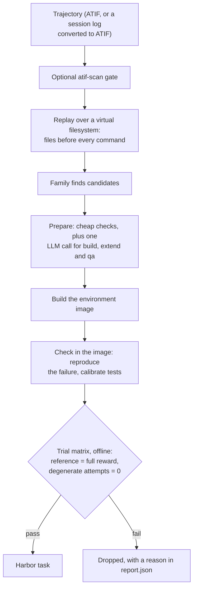
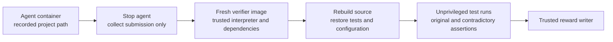

The input is a set of agent trajectories, not a repository. Each trajectory is
replayed over a virtual filesystem, so every shell command the agent ran comes with
the files as they were just before it. Task *families* mine candidates from that
replay: a check the agent fixed, the project its first request asked for, its next
feature request, or a fact it computed from Hugging Face data. Every candidate gets
its own environment image and a trial matrix run offline in Docker. The task is kept
only if the reference scores full reward and degenerate attempts score 0.

## At a glance

| | |
|---|---|
| Input | ATIF `.json` trajectories, or raw Claude Code, Codex or pi session logs (`.jsonl`) converted on the fly |
| Task | Depends on the family: repair a failing check, build a project from its request, implement the next request, or answer a data question |
| Reward | `repair` and `qa`: 1/0. `build` and `extend`: fraction of hidden tests passed |
| Needs an LLM | `repair`: no. `build`, `extend`, `qa`: one call per candidate, cached on disk |
| Needs Docker | Yes, for every family: image build and trials |
| Hosts | Local trajectory files; no repository host involved |
| Languages | `repair`: Python and Node checks. `build` and `extend`: Python projects |
| Status | Experimental |
| Reference dataset | None published yet |

## Quickstart

```bash
repo2rlenv generate --config examples/trajectory-to-env.yaml
```

```yaml title="examples/trajectory-to-env.yaml"
source:
  kind: trajectory
  path: workspace/trajectories  # ATIF .json files, searched recursively
  format: atif                  # or claude-code, codex, pi
pipeline:
  name: trajectory_to_env
  options:
    families: [repair]
    limit: 5
output:
  destination: workspace/trajectory-tasks
  org: local
  dataset_name: trajectory-tasks
```

`repair` needs no LLM. For the other families, add an LLM, for example
`--pipeline-opt families=build --llm anthropic/claude-opus-5-5`. Each task lands in
`workspace/trajectory-tasks/<task-id>/`, next to a `report.json` that records why
every candidate was kept or dropped. Run the oracle, which should score 1.0:

```bash
harbor run -p workspace/trajectory-tasks -a oracle --env docker
```

## How it works



1. **Convert** session logs to ATIF-v1.7 when `format` isn't `atif`. Only what the
   log recorded is emitted; missing fields stay absent.
2. **Gate** each trajectory with [atif-scan](https://github.com/huggingface/atif-scan)
   when it is installed. Findings such as reward tampering or benchmark access drop
   the whole trajectory.
3. **Replay** the trajectory. Writes, edits, full reads, Codex `apply_patch` and shell
   heredocs rebuild the files; files that can't be rebuilt are marked lost.
4. **Find candidates** per family:
   - `repair`: a check (tests, build, lint) that failed, then passed after file edits
     and nothing else.
   - `build`: the Python project at the end of the first request.
   - `extend`: request k+1 on top of the project as it was after request k.
   - `qa`: a fact computed from Hugging Face dataset files in one tool output.
5. **Prepare.** `build` and `extend` ask the model for an interface contract and
   candidate pytest tests; `qa` asks it for questions with exact answers.
6. **Build** the task image. `repair` pins npm to the trajectory's date; `qa` pins its
   input files to the dataset commit that was current at that date.
7. **Check in the image.** `repair` must fail the way the trajectory recorded.
   `build` and `extend` calibrate each test against the reference, a stub and the
   start state, then require a minimum mutant kill rate.
8. **Run the trial matrix** with networking off. Apply a control in the agent
   container, stop it, then transfer only the submission into a fresh verifier.
   Project tasks transfer `/workspace`; QA transfers `/workdir/answer.txt`.
   The agent never receives `/tests`. The verifier rebuilds source against the
   pristine image, restores test configuration, and runs project tests as an
   unprivileged user. Supported assertions receive contradictory test controls
   through the same verifier used by the native runtime pipelines.



Every candidate is staged privately and published only after its controls pass.
Duplicates and failed reruns preserve existing task directories. Per-input and
provider failures are recorded in `report.json` while other inputs continue.
An installed scanner that errors or cannot resolve the blocking checks does not
produce a clean label; its input is retained as a skipped record. Explicit
`scan=false` and an absent optional scanner remain distinguishable in the report.

## Model calls

| Family | Input | Output | Kept when |
|---|---|---|---|
| `build` | The first request and the reference project | Contract, behavior-free stub files, candidate tests | At least 6 tests pass on the reference twice, fail on the stub and an empty workspace, and catch 60% of mutants |
| `extend` | Request k+1, the project after request k and the reference after k+1 | Contract and candidate tests | At least 5 new tests, and 50% of mutants of the changed code caught |
| `qa` | The rendered trajectory | Questions, gold answers, cited tool output, input files, reference solution | The answer is verbatim in the cited output and every input resolves to a pinned commit |

The prompts live next to each family in
[`pipelines/trajectory/families/`](https://github.com/huggingface/Repo2RLEnv/blob/main/src/repo2rlenv/pipelines/trajectory/families/).
Calls go through the shared LiteLLM client with a strict JSON schema. Responses are
cached under `llm_cache_dir`, so reruns are free and stable.

## Options

Pass each option with `--pipeline-opt key=value`.

| Key | Default | What it does |
|---|---|---|
| `families` | `[repair]` | Families to run: any of `repair`, `build`, `extend`, `qa`. A comma-separated string also works |
| `limit` | none | Only the first N trajectories |
| `jobs` | `4` | Trajectories processed in parallel |
| `scan` | `true` | Run the atif-scan gate. Without atif-scan installed, every trajectory passes and the report says so |
| `propose_only` | `false` | Stop after the LLM calls, filling the cache, without Docker |
| `platform` | `linux/amd64` | Image platform. `native` uses the host architecture, which is faster on Apple silicon; validate on `linux/amd64` before publishing |
| `max_llm_tokens` | `32000` | Output token budget per LLM call. Reasoning models spend it on thinking too; raise it, or lower `reasoning_effort`, if candidates come back `llm_declined` |
| `reasoning_effort` | none | `low`, `medium` or `high`, sent to providers that support it. Unset leaves the provider default |
| `llm_cache_dir` | `workspace/cache/trajectory_to_env/llm` | LLM response cache. Failed or truncated replies aren't cached, so a rerun retries only those |
| `container_memory` | `4g` | Memory cap for every trial container |
| `max_llm_spend_usd` | `5.0` | LLM spend cap for the run, in USD; `0` is unlimited. `generate --max-spend-usd` overrides it. Cached replies are free. Once the cap is hit, further candidates are skipped as `budget_exhausted`; calls already in flight finish, so a run can overshoot by up to `jobs` calls |

## Output

```files
<task-id>
├── task.toml
├── instruction.md
├── environment
│   └── Dockerfile
├── solution
│   └── solve.sh
└── tests
    ├── test.sh
    └── …            # protected check files, hidden tests or the grader, per family
```

- `task.toml`: Harbor task. `[metadata]` records the family, `source_trace` and
  `source_model`. `[metadata.repo2env]` records `pipeline`, `recipe = "trajectory_replay"`,
  `reward_kinds = ["test_execution"]` and `reproducibility.mode = "inline_dockerfile"`.
  The [evaluation label](task_evaluation_labels.md) starts as `unverified`.
- `solution/solve.sh`: restores the reference files directly. There is no `patch.diff`.
- `tests/test.sh`: writes the reward to `/logs/verifier/reward.txt`.

Task IDs are `<session>-<fix hash>` for `repair`, `<session>-build`,
`<session>-extend-<n>`, and a 12-character hash for `qa`.

## Reward

| Family | Reward | Verifier |
|---|---|---|
| `repair` | 1.0 only when the recorded check passes; otherwise 0.0 | Native separate verifier, tracked test IDs where available; test hooks and installed dependencies cannot cross as source |
| `build` | Fraction of hidden tests passed | Calibrated pytest module, `tests/test_hidden.py` |
| `extend` | Fraction of new tests passed, or 0 if any existing test fails | Calibrated pytest module, split SWE-bench style into new and existing tests |
| `qa` | 1.0 for a matching answer, else 0.0 | Typed exact answers: finite decimal numbers, normalized labels/yes-no, or unordered lists. No percentage inference or LLM judge |

## Yield and cost

A local smoke run on 40 Codex trajectories with `families=[repair]` found 3
candidates and emitted 2 tasks; 1 was dropped as `check_fails_differently`. It took
38 seconds on Apple silicon with `platform: native`. Both tasks passed
`repo2rlenv validate --oracle` and scored 1.0 with Harbor's oracle agent. That's a
smoke test, not a yield measurement: no collection has been generated or published.

What moves yield: how often trajectories run a check that fails and then passes
(`repair`), whether the project is Python and fits the prompt (`build` and `extend`,
capped at 150,000 characters), and how many files the replay could rebuild. Cost is
one cached LLM call per `build`, `extend` or `qa` candidate; `repair` makes none.
The run stops calling the model at `max_llm_spend_usd` ($5 by default). Spend comes from
LiteLLM's price table, or from the cost the provider reports when LiteLLM can't price the model.

## Limits

- **A generated task isn't a verified environment.** Run the controls and record an
  evaluation label; see [Quality](../concepts/quality.mdx).
- **Tasks from one trajectory can be near-duplicates.** Split training and evaluation
  data by `source_trace`.
- **Trace datasets often carry no license.** Publish privately until redistribution
  is cleared.
- **Harbor 0.25 or later is required.** Every task uses a separate verifier and
  explicit `network_mode = "no-network"`. QA downloads pinned data while building
  the image; agent and verifier execution stay offline.
- **Tamper detection is bounded.** Contradictory assertions detect known in-process
  result forgeries; they are not a proof against arbitrary malicious programs.
  Build/lint repair checks without parseable test IDs have no assertion controls.
- **Local files only.** `hf://` trajectory paths aren't supported yet.
- **Native generation needs Docker.** Set `DOCKER_HOST` for a remote Docker worker.
  Emitted bundles include their build context and can be rebuilt by Harbor's
  Docker, Modal or Daytona provider; published bundles need no controller-local image.

## Related

- [RFC 0034: trajectory_to_env](../rfcs/0034-trajectory-to-env.md)
- [Tasks](../concepts/tasks.mdx), [Rewards](../concepts/rewards.mdx) and [Run with Harbor](../guides/run-with-harbor.mdx)
- The `qa` grader is adapted from [SmolDataEnvs](https://huggingface.co/datasets/FineEnvs/SmolDataEnvs-harbor-train) (MIT); see the [third-party notices](https://github.com/huggingface/Repo2RLEnv/blob/main/THIRD_PARTY_NOTICES.md).

## Implementation notes

Source: [`pipelines/trajectory/`](https://github.com/huggingface/Repo2RLEnv/blob/main/src/repo2rlenv/pipelines/trajectory/).
`pipeline.py` is the entry point. Each family subclasses `task.Family`, and
`make_tasks` drives the lifecycle.

The checks and the skip reasons they record:

| Check | Rejects when | Skip reason |
|---|---|---|
| Gate | atif-scan reports a blocking finding | `gate` |
| Duplicate | A task with the same ID was already made in this run | `duplicate` |
| LLM | The model declines, or its output doesn't parse | `llm_declined` |
| Size | The `extend` prompt exceeds 150,000 characters | `project_too_large` |
| `qa` grounding | The answer isn't verbatim in the cited output, appears in the question, or an input can't be pinned | `answer_not_in_cited_output`, `answer_in_question`, `input_not_resolvable` |
| `qa` inputs | Missing dated evidence, or empty/colliding input filenames | `missing_trajectory_date`, `missing_trajectory_timezone`, `invalid_inputs` |
| `repair` fix scope | The fix edits the check's own configuration | `fix_changes_check_config` |
| Image | `docker buildx build` fails | `image_build_failed` |
| `repair` reproduction | The check passes before the fix, or fails with different errors | `check_passes_before_fix`, `check_fails_differently` |
| Calibration | Calibration produced no results, or the hidden tests didn't load before the request (`extend`) | `calibration_failed`, `tests_not_collected_before` |
| Test strength | Too few discriminating tests, or too low a mutant kill rate | `weak_tests` |
| Trials | Any trial's reward differs from the expected one | `trials_failed` |
| Budget | The run's LLM spend reached `max_llm_spend_usd` | `budget_exhausted` |

- `solution/solve.sh` restores reference files, so `[metadata.repo2env].recipe` is
  set and `validate --oracle` doesn't require a `patch.diff`.
- Generated bundles retain the uniform `unverified` evaluation label. Passing
  construction controls does not substitute for the review and blind rollout
  evidence required by the quality loop.

## Regression checks

The `Trajectory lifecycle and Harbor controls` CI job runs real Docker generation
controls and Harbor trials for all four families, using small deterministic
projects and no model calls. The Harbor cases cover the reference, no-op,
in-process result forgery and injected pytest-hook submissions. To exercise the
same emitted tasks on Modal (remote image builds):

```bash
R2E_HARBOR_TESTS=1 R2E_HARBOR_PROVIDER=modal \
  uv run --all-extras --frozen pytest tests/test_trajectory_execution.py -q
```

Provider credentials are required. These opt-in tests incur sandbox charges,
delete their agent/verifier sandboxes afterward, and make no model calls.
The ordinary test suite covers unsafe paths, duplicate preservation, malformed
inputs, scan failures, parameterized test selection and strict answer grading.
- `tests/test_trajectory_execution.py` covers all families with real generation
  controls and Harbor oracle/no-op/forgery controls. CI runs these on Docker;
  `R2E_HARBOR_TESTS=1 R2E_HARBOR_PROVIDER=modal` selects cloud validation without
  local image builds. Synthetic fixtures exercise the mechanics, not dataset yield.
