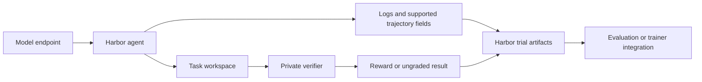

Harbor owns agent execution. Repo2RLEnv supplies the task and verifier; the chosen
Harbor agent attempts it and returns logs, a trajectory and a reward result.
An agent log is not automatically a training-ready token trace.

## Choose an agent

<a id="1-the-25-built-in-agents"></a>

Use `harbor run --help` for the list in your installed version. Examples include
`claude-code`, `codex`, `pi`, `opencode`, `openhands` and `terminus-2`. The list
changes between Harbor releases; the canonical names live in
[Harbor's agent enum](https://github.com/harbor-framework/harbor/blob/main/src/harbor/models/agent/name.py).

| Agent | Use |
|---|---|
| `oracle` | Run the reference solution and check its expected reward |
| `nop` | Check the untouched starting state |
| Coding-agent harness | Measure a model/harness combination on the task |
| `terminus-2` | Harbor's terminal agent, with optional detailed rollout capture |

```bash
harbor run -p ./tasks -a claude-code -m anthropic/claude-sonnet-4-6 \
  --ak max_budget_usd=2.00 \
  --ae ANTHROPIC_API_KEY="$ANTHROPIC_API_KEY" --env docker
```

This example assumes deterministic verifier rewards. PR-diff tasks also need
judge credentials through `--ve`; see [Run with Harbor](../guides/run-with-harbor.mdx).

## 2. Agent contract

`-a` selects the harness and `-m` its model. `--ak KEY=VALUE` passes harness options;
`--ae KEY=VALUE` supplies agent environment variables. Options are specific to the
harness: a Claude Code spending flag does not cap another agent or verifier.

Harbor's `BaseAgent` defines the shared interface. `BaseInstalledAgent` supports
harnesses installed inside the task environment. Custom agents can use
`--agent-import-path package.module:AgentClass`. Consult the installed version's
implementation before relying on a particular constructor or option.

Tasksmith's Pi/OpenCode **author adapters** are separate from Harbor's **learner
agents**. Authoring may inspect the private PR diff; the learner receives only the
public task and workspace. Changing one does not select the other.

## 3. LLM hosting

The harness connects to its model provider or a self-hosted inference endpoint.
The model, API format, endpoint and authentication must all be supported by that
harness. A model being available through an OpenAI-compatible API does not establish
compatibility with every agent.

For remote sandboxes, an endpoint on your controller's `localhost` is not reachable
as the sandbox's `localhost`. Test endpoint access from the chosen runtime and keep
the task's network policy in mind. Offline task execution and model inference
access are distinct parts of the harness integration.

## 4. RL traces + logprobs: how data leaves the sandbox



Harbor collects artifacts under `jobs/<job>/<trial>/`, including `agent/`,
`verifier/` and `result.json`. The environment adapter handles transfers or mounts;
consumers should use the returned artifacts rather than assume a provider-specific
filesystem layout.

An ATIF trajectory contains interaction history. Detailed RL data may additionally
include prompt token IDs, completion token IDs and corresponding log probabilities.
Those fields depend on **both the harness and the model endpoint**. Check the saved
result before treating them as available.

## 5. Two paths for token-ID capture

1. **Harness capture.** Terminus 2 has a `collect_rollout_details` option. Enable
   it only with an endpoint that supplies the required information, then inspect
   `agent_result.rollout_details` in the saved trial.
2. **Inference instrumentation.** A controlled endpoint or proxy can retain model
   requests and token-level outputs. This requires your own alignment between
   model calls, agent steps, tokens and rewards; Repo2RLEnv does not supply that
   trainer integration.

Ordinary API responses, textual logs and token-usage counts do not necessarily
provide token IDs or log probabilities. Do not infer missing values from a successful
agent run. Compaction, subagents and retries can create multiple trace segments.

## 6. What this means for Repo2RLEnv

Choose the generation route for the **task and reward**, and the Harbor agent for
the **evaluation or training trace** you need. All task families can be attempted
by a compatible agent; `pr_diff` still runs a verifier and is not a text-only
replacement for Harbor execution.

Report the task revision, Harbor version, harness, model and reward contract with
results. Keep ungraded trials separate from scored failures.

## 7. References

- [Run with Harbor](../guides/run-with-harbor.mdx): controls, credentials, concurrency and results.
- [Harbor agents](https://www.harborframework.com/docs/agents): upstream integration documentation.
- [Terminus 2](https://www.harborframework.com/docs/agents/terminus-2): upstream terminal agent.
- [Rollout detail schema](https://github.com/harbor-framework/harbor/blob/main/src/harbor/models/agent/rollout_detail.py): optional token-level fields.
- [Agent base](https://github.com/harbor-framework/harbor/blob/main/src/harbor/agents/base.py): current shared interface.
