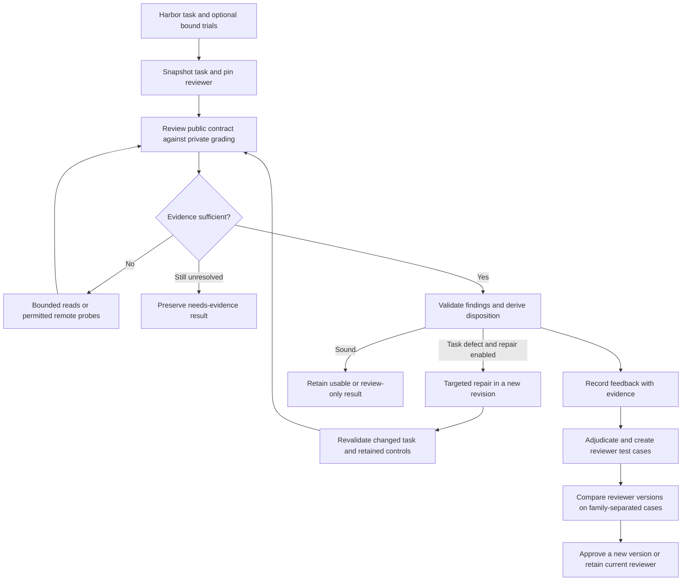

**Status:** experimental implementation on `codex/quality-reviewer-rfc`; not released

**Author:** Repo2RLEnv maintainers, with Codex assistance

**Created:** 2026-10-16

**Design baseline:** `origin/main` at `27d04ee8`; extends [RFC 0027](0027-harbor-quality-loop.md)

## Summary

Extend the shared Harbor quality loop with auditable findings and an evaluation
suite for the reviewer itself. Keep generation, task rewards and the existing
repair engine separate: the reviewer must identify a concrete task defect before
repair can act, and its own accuracy must be measured against independently
audited cases. All pipeline integration code remains owned by Repo2RLEnv.

The first deliverable is an opt-in review profile and a CPU-first, 20-family
pilot. Recommended external API/cloud cap: **$150**, with **$70–$120 expected**
under the assumptions below. The user approved this separate cap with “go ahead” on 16 October 2026; the
campaign authorization and ledger are retained locally.

## Motivation

The existing loop already checks task/verifier alignment, reads bounded evidence,
executes wrong-solution and valid-alternative controls, distinguishes rollout
outcomes and preserves repaired revisions. More review calls alone do not tell
us whether the reviewer is correct. We need to measure false accusations as well
as missed defects, and retain the reasoning behind accepted corrections.

Micro1's [Flow-QC article](https://www.micro1.ai/blog/flow-qc) motivates this work:
it describes evidence-grounded task and rollout review, clean/defective task pairs,
adjudicated feedback and offline instruction optimization. This is an independent
adaptation of public ideas. We do not have their internal implementation, complete
prompts or evaluation corpus, and do not claim to reproduce their production results.

The argument against a new subsystem is strong: [the existing quality
loop](../pipelines/quality_loop.md) already handles most execution. Therefore this
RFC adds contracts and reviewer evaluation around that loop, not another generator,
agent harness, reward model or cloud abstraction.

## Design

### Input

Accept an immutable Harbor task directory from any recipe or Tasksmith, plus
optional baseline, oracle, probe and solver receipts. Existing hash/checksum
binding rules remain authoritative. A review may inspect `instruction.md`,
`task.toml`, environment/build inputs, private tests, reference solution and
bound rollout artifacts. Missing material is recorded, never invented.

Optional author context records the intended public behavior, PR provenance and
why a test exists. Context helps investigation but cannot silently add requirements
to the learner's instructions. Keep this material outside learner-visible files.

The pilot supports the existing binary quality contract. Graded optimization
tasks, including FrontierSmith, may receive static findings but cannot receive
full acceptance through this profile. Their feasible alternatives need a different
score contract; changing `success_reward` alone does not supply one.

### Interface

Retain `repo2rlenv quality run` and `quality show`. Add an explicit profile option
so existing callers continue using `practical-generation-v1` by default. The new
profile is named `evidence-review-v2`.

**Review with existing evidence; model calls, no new solver or probes:**

```bash
repo2rlenv quality run ./tasks/example \
  --profile evidence-review-v2 \
  --campaign ./workspace/qc-pilot \
  --out ./workspace/qc-pilot/reviews/example \
  --rollout ./jobs/example/trial/result.json \
  --review-model anthropic/claude-sonnet-4-6
```

**Review and bounded repair with fresh remote validation:**

```bash
repo2rlenv quality run ./tasks/example \
  --profile evidence-review-v2 \
  --campaign ./workspace/qc-pilot \
  --out ./workspace/qc-pilot/repaired/example \
  --repair --provider daytona \
  --runtime-wheel ./dist/repo2rlenv-0.9.3-py3-none-any.whl \
  --review-model anthropic/claude-sonnet-4-6 \
  --max-repairs 3 --max-spend-usd 5
```

The wheel path is illustrative; use the wheel built from the implementation
checkout. A per-task cap is a stop condition, not a guarantee that repair finishes.
`--provider modal` uses the same CPU execution contract. Existing native GPU
support remains Modal-only; provider capability checks happen before allocation.
Remote tools, tests and builds never execute on the local controller.

Implemented commands (see the [usage guide](../pipelines/evidence_review.md)):

| Command | Purpose | Paid effects |
| --- | --- | --- |
| `quality benchmark validate MANIFEST` | Check hashes, labels and family splits | None |
| `quality benchmark run MANIFEST --split SPLIT --config CONFIG --campaign DIR --out DIR` | Compare pinned reviewer profiles on identical cases | Metered static model reviews; no new task execution |
| `quality benchmark show DIR --json` | Display paired results, coverage and costs | None |
| `quality feedback record REVIEW --issue ID --author NAME --decision disputed --reason-file FILE --out DIR` | Preserve attributed feedback; decisions also include confirmed and corrected | None |
| `quality feedback adjudicate FILE --config CONFIG --campaign DIR --out DIR` | Request a separately metered model second opinion | Metered model calls; ambiguity remains unresolved |

`quality show DIR` displays the exact task/reviewer revisions, criterion decisions,
evidence coverage, issue locations, costs and missing checks using the shared Rich
console. `--json` is the stable machine interface. Preserve existing exit codes;
benchmark `run` distinguishes completion from whether a candidate qualifies for
promotion. It must not claim success because it merely produced reports.

Keep `QualityLoop.run()` as the Python entry point. Profile selection is an
additive `LoopOptions` field. New result types are versioned; the legacy parser
must continue reading old files. Benchmark and feedback code call existing model,
budget and remote adapters rather than adding alternate provider clients.

### Algorithm



1. Freeze task bytes and imported evidence before review. Bind reviewer identity
   to prompt/skill hashes, code, model route, generation settings and tool limits.
2. Build a bounded evidence view, prioritizing instruction and actual failed
   assertions. Existing citations and document readers remain in use.
3. Ask for material defects, permitted counterexamples and missing evidence.
   Review-only mode can request execution but cannot silently allocate a worker.
4. Validate quoted excerpts and evidence identities mechanically. A model cannot
   declare that a probe ran; only a completed, bound receipt establishes execution.
5. Derive assessment/disposition in code. Valid solver failure is compatible with
   a sound task. Infrastructure failure or missing assertions leave relevant checks
   unresolved. Optional polish is advisory, not a rejection.
6. Route confirmed task defects to the existing bounded repair loop when enabled.
   Re-run affected validation; keep original task, failed attempts and costs.
7. Persist feedback independently of task disposition. A disputed finding does not
   become false merely because someone disagrees. Adjudication records evidence,
   reviewer identity and unresolved disagreements; no silent deletion of findings.
8. Evaluate a candidate reviewer against the unchanged baseline before promotion.
   Benchmark labels and previous baseline decisions are hidden from both reviewers.

### Finding and evidence contracts

Use one stable ID per issue within an immutable review. Track later occurrences
through explicit links rather than guessing that similar wording identifies the
same defect. Extend existing categories without changing old serialized records.

| Record | Required content |
| --- | --- |
| Review identity | Schema/profile versions, task hash, reviewer hash, evidence-set hash, model/settings, run ID |
| Criterion | Stable criterion ID, `pass`/`fail`/`unknown`, explanation, supporting evidence IDs |
| Finding | Issue ID, criterion ID, category, blocking/advisory severity, concrete problem, grading consequence, proposed repair and target component |
| Attribution | Task, solver, infrastructure, mixed or unresolved; evidence supporting that attribution |
| Evidence | File hash/path/excerpt with optional line range; or trial receipt and observation; or reproducible derivation with input references |
| Investigation | Hypothesis, permitted probe, expected discriminating outcomes, observed result, rejected alternatives and unresolved limitations |
| Confidence | Low/medium/high reviewer assessment, explicitly not a calibrated probability |
| Feedback | Original finding/review IDs, author identity or role, rationale, evidence references, adjudication and superseding records |

Start with requirement alignment, feasibility/assets, reference correctness,
verifier coverage, valid alternatives, reward gaming, leakage and rollout/grade
agreement. These are Repo2RLEnv criteria, not a claim to copy Micro1's private rubric.
Keep current task/verifier/leakage aggregates as a compatibility view.

Invariants: every failed criterion has a grounded blocking finding; a passing
criterion cannot own a blocking finding; unsupported hypotheses remain unresolved;
all linked evidence must exist and match its digest. Effective ratings are derived:
a grounded blocking finding overrides a proposed pass; an unsupported failure
becomes unknown. Raw responses and these corrections remain auditable. Advisories live separately
from defect findings. New fields on historical reviews remain explicitly absent;
do not infer confidence, attribution or observed evidence during migration.

### Output

Review output lives beside the task, under the campaign, not in the learner image:

```text
reviews/CASE/
  result.json              # versioned final result and compatibility view
  findings.json            # pointer to latest accepted review
  reviews/KEY/
    findings.json          # criteria and stable issue IDs
    evidence.json          # exact excerpts, file hashes and bound trials
    investigation.json     # hypotheses and supported/dismissed/unresolved conclusions
    reviewer.json          # pinned code, prompts, model and settings
  calls/                   # immutable metered requests and response receipts
  revisions/              # existing immutable repair outputs, if any
```

CLI summaries and a human-readable report link to these records. Reuse existing
`[metadata.repo2env.evaluation]` labels only through their current publication
contract; a static review does not automatically promote a task to `verified`.
No new metadata is needed in the Harbor task for the first pilot. Published task
bytes and historical grades remain intact unless an explicit new revision ships.

## Verification

### Two different kinds of mutation

Existing semantic probes mutate a **solver submission** to test the **verifier**.
The new benchmark mutates a **task or verifier** to test the **reviewer**. Keep the
APIs, manifests and labels separate so a successful probe cannot be mistaken for
evidence that the reviewer is accurate.

For the initial binary profile, retain the baseline/reference contrast and require
the reference to reach the task's declared success reward, normally 1. A valid
alternative must preserve public behavior; a wrong-solution control must fail for
the intended behavioral reason, not import/setup damage. Unchanged private tests
run outside the learner. Never weaken a legitimate test to increase solver success.

### Pilot corpus and protocol

Target **20 CPU task families**, preferably four from each HF ML repository where
independently auditable candidates exist. Do not fill a repository quota with
uncertain labels. Reuse existing frozen tasks and saved rollouts where hashes
match; do not rerun all fifty solvers. GPU traces can inform later cases, but new
GPU execution and graded-reward tasks are outside this pilot budget.

Each family has one independently audited clean task and two separate variants,
each introducing exactly one defect: **60 cases total**. Candidate defects include
undocumented exception wording, private-state overfitting, a missing required asset,
ordering/tolerance mismatch, answer exposure, stale-output acceptance and removal
of a central behavioral assertion. Existing real false-rejection examples are
preferred where their labels can be independently established.

Do not equate an old `verified` label or an oracle pass with a clean label. A second
reviewer checks each proposed clean case and each mutation rationale. A separate
model can assist triage, but unresolved cases remain outside the scored clean set.
Retain exclusions and reasons; they affect achieved corpus size.

Freeze **10 development / 5 selection / 5 final-test families** before tuning.
Group by PR/commit lineage and shared feature or near-duplicate implementation,
not just task ID. All variants and correction descendants stay in the same group.
This is not a claim of unseen-repository generalization.

Compare the baseline and one frozen candidate using the **same pinned model,
tools and budget**, with **two independent runs per case/profile**: at most
`60 × 2 × 2 = 240` review sessions. Selection results choose the candidate; final
test runs occur only after that choice. Repeated sessions must bypass model-response
cache reuse; immutable task/probe evidence may still be reused. Resuming the same
session reuses its receipts and never charges for duplicate dispatch.

The scorer never exposes clean/defective labels, mutation patches, expected
criterion/location, meaningful variant names or adjudication notes to the reviewer.
Only allowlisted task bytes and scenario-appropriate evidence enter its context.
After tuning uses final-test feedback, that set is retired as a fresh holdout.

### Metrics and promotion

Report counts and denominators for defect detection at the correct shared category
and location (the legacy reviewer has no seven-criterion IDs), blocking findings on clean tasks, independently adjudicated finding
precision, abstentions, execution errors, schema violations, tokens, cost and latency.
Report definite decisions and total attempted coverage separately; unknown cases
cannot disappear from the denominator. Wrong-location findings do not count as
catching the planted defect. Genuine additional defects trigger label adjudication.

Detection rate is correctly localized planted defects divided by all eligible
defective-case attempts. The initial scorer reports blocking on proposed-clean cases divided by all eligible
clean-case attempts. Unexpected findings need adjudication before this is interpreted
as a false-positive rate; provisional labels are reported separately.
Decision coverage is decidable completed attempts divided by all scheduled attempts.
Finding precision uses all adjudicated findings in the pilot, with counts for any
unadjudicated remainder. Repeat samples stay clustered by family in comparisons.

Compute uncertainty by resampling task families while retaining variants and
repeated runs together. Twenty families provide a pilot signal, not a precise
production accuracy claim. A candidate must pass deterministic contract tests and
known regression cases, reduce false blocking findings without observed detection
regression on selection/final cases, and stay within the declared budget. If the
comparison is inconclusive, keep it opt-in and retain the current default. Do not
translate a small observed win into a universal accuracy guarantee.

### Required implementation checks

- Old result files and the current default profile still work; v2 is explicit.
- Fabricated quotations, cross-task receipts and inconsistent findings are rejected.
- A solver timeout cannot manufacture a task defect; an undisclosed exact-message
  test cannot be treated as an implicit public requirement.
- Benchmark labels and lineage variants cannot leak into reviewer inputs or splits.
- Probe setup failure is unresolved instrumentation, not successful defect detection.
- Resume is idempotent; uncertain provider charges remain held; cancellation cleans
  up owned workers without modifying caller-owned worker lifecycle.
- Mutation fixtures prove the intended one-defect change; both clean and defective
  cases are tested. No local execution of generated task code is required.

## Anti-contamination

Private reference solutions and tests are visible only to the trusted reviewer and
verifier, never the blind solver. No author feedback or benchmark labels are copied
into the Harbor learner image. Treat task files, logs and prior findings as untrusted
data; instructions inside them cannot override the review protocol. Probe execution
uses the existing offline remote boundary with controller-held credentials.

Separate task content hashes from report annotations. A repaired task invalidates
incompatible execution evidence and requires fresh checks. No historical score is
silently relabeled after a repair or an accepted feedback entry.

## LLM use and budget

Models are used at **review and optional repair**, not added to deterministic reward
computation. Baseline and candidate use one explicit route. Start with the existing
`anthropic/claude-sonnet-4-6` integration for a controlled comparison; this is not a
claim that it is the latest or best model. Other supported routes remain configurable.
Changing the model is a separate experiment, not a reviewer-prompt improvement.

### Cost assumptions, checked 16 October 2026

[Anthropic lists Sonnet 4.6](https://platform.claude.com/docs/en/models/sonnet-4-6/overview)
at $3 per million input tokens and $15 per million output tokens. A planning call
with 20,000 input and 2,000 billed output tokens costs `$0.06 + $0.03 = $0.09`.
At two to three calls per review, 240 reviews imply **$43.20–$64.80** of inference.
These token volumes are assumptions, not measurements. All billed reasoning,
context expansion, retries and adjudication calls count; no cache discount is assumed.

[Daytona's posted CPU rates](https://www.daytona.io/pricing) imply about **$0.3312/hour**
for 4 vCPU and 8 GiB, before storage: `4 × $0.0504 + 8 × $0.0162`. A planning
20–50 aggregate sandbox-hours costs **$6.62–$16.56** before build/storage overhead.
The exact worker resources must satisfy the task. Modal remains an alternative;
use its [current rates](https://modal.com/pricing) when dispatching there.

| Pilot allocation | Maximum envelope |
| --- | ---: |
| Baseline/candidate review sessions and model-backed case triage | $80 |
| Focused independent adjudication/escalation | $15 |
| Remote CPU probes, missing controls and builds | $25 |
| Retry, uncertain-charge and sizing headroom | $30 |
| **Total proposed hard cap** | **$150** |

Expected total: **$70–$120**; the hard cap is a ceiling, not a spend target or a
promise to finish if cases require substantially more investigation. Code, RFC and
local synthetic tests need **no additional provider/cloud spend**; this excludes
the user's existing coding-assistant subscription and human review time.

After a five-family smoke, recompute the estimate from actual tokens and cloud
receipts before dispatching the remaining families. Stop if the remaining work
does not fit the cap. Start with four concurrent model reviews and two remote CPU
trials, bounded by actual provider quotas. Record known costs and unresolved holds
separately. Do not reuse old campaign authorization or silently increase the cap.

For later routine usage, the same assumptions suggest **$18–$27 per 100 review-only
tasks**, excluding probes, repair, escalation and retries. This is a projection to
replace with measured per-task economics, not a quoted production price.

Optional GEPA optimization is a later experiment: provisionally **$100–$200 extra**
for a bounded search and a new comparison. It is excluded from the $150 pilot and
requires a separate measured plan. A useful reviewer and benchmark do not depend
on enabling it.

## Yield and repository suitability

This component produces review evidence, not new environments. Report attempted,
completed, decidable and independently adjudicated reviews separately. The target
is 20 audited families, not 20 assumed-good tasks; achieved corpus size depends on
label audit. Existing Harbor tasks from every generator can use the review API.
The initial scored benchmark deliberately limits execution to CPU/binary tasks.

No quality target is defined as a solver success rate. Difficult tasks remain
valuable when the public contract, reference and verifier agree. A reward-zero
rollout can therefore receive a sound-task assessment.

## Dependencies and code placement

| Location | Responsibility |
| --- | --- |
| `src/repo2rlenv/quality/loop/` | Existing runner, model client, exact evidence reads, repair and remote execution; additive profile hook |
| `src/repo2rlenv/quality/reviewer/` (new) | Versioned findings, evidence ledger, profile definitions and disposition validation |
| `src/repo2rlenv/quality/benchmark/` (new) | Case manifests, family splitting, comparison scheduler and deterministic metrics |
| `src/repo2rlenv/quality/feedback.py` (new) | Attributed feedback records and adjudication workflow |
| `tests/test_quality_{reviewer,benchmark,feedback}.py` | Original synthetic fixtures and regression cases |
| `workspace/quality-reviewer-pilot/` (ignored) | Real task copies, traces, labels, requests, costs and generated reports |

Reuse Pydantic, the shared console, campaign ledger, event journal and remote
execution adapters. No new mandatory dependency or upstream research-repository
installation. GEPA, if later adopted, is an optional pinned library used offline;
the shipped review profile remains usable without it. Preserve license/source
metadata on real tasks; do not commit entire third-party repositories or credentials.

## Alternatives considered

- **Another generation pipeline:** duplicates existing quality integration and does
  not evaluate reviewer errors. Extend the shared quality command instead.
- **A stronger reviewer model first:** could help, but confounds model choice with
  protocol changes. Establish a fixed-model baseline first.
- **Automatic prompt optimization immediately:** optimizes uncertain labels before
  we know the benchmark is trustworthy. Build and audit cases first.
- **One combined quality score:** hides the difference between task defects, missing
  evidence and infrastructure failure. Keep criterion decisions and execution state.

## Rollout plan

| Stage | Deliverable | Completion gate |
| --- | --- | --- |
| 0. Design | This RFC, interface, economics and integration map | Scope and paid cap agreed before paid execution |
| 1. Contracts | Opt-in v2 records, invariants and old-result adapter | Compatibility, citation and disposition tests pass without paid services |
| 2. Benchmark | Manifest validator, lineage splits, scorer and synthetic cases | Known defects/clean cases score correctly; reviewer never sees labels |
| 3. Integration | CLI/JSON UI and shared-loop hook | Same task works through legacy and explicit v2 paths; no default behavior change |
| 4. Five-family smoke | Metered reviews and focused CPU probes | Providers, receipts, cleanup and measured completion cost verified |
| 5. Twenty-family pilot | Up to 240 sessions, selected candidate, final holdout report | Costs within cap; counts, exclusions and uncertainty published locally |
| 6. Release decision | Human-readable findings and proposed default policy | Evidence supports promotion; otherwise keep experimental and document gaps |

Stages 1–3 are roughly **2–4 focused engineering days**, with case adjudication
potentially adding **1–2 days**. Paid execution should be scheduled from smoke
measurements rather than promised from review latency alone. These are planning
estimates, not an unattended completion guarantee.

Tasksmith and all recipes call the same opt-in quality profile. Do not add per-recipe
review implementations. No task dataset is republished, benchmark result announced
or default switched merely because this RFC or its code has merged.

## Open questions

- **Budget:** a separate $150 cap is approved. Paid pilot evidence stays in the
  ignored campaign directory; no previous campaign allowance is reused.
- **Independent labels:** unresolved clean-task disputes need a maintainer or domain
  reviewer; model agreement alone is not ground truth. Record this labor separately.
- **Corpus size:** confirm twenty sufficiently independent CPU families exist after
  audit; report a smaller defensible pilot if they do not.
- **Optional optimization:** decide on GEPA only after the first comparison and
  observed costs; retain a fresh holdout for further iterations.

## References and credit

- Rumi Elias Calles and Tyler Houchin, micro1, [Teaching the reviewer: Introducing
  flow QC](https://www.micro1.ai/blog/flow-qc), 13 October 2026. Method inspiration;
  no upstream source code, proprietary prompts or evaluation data copied.
- [GEPA](https://github.com/gepa-ai/gepa) and its
  [paper](https://arxiv.org/abs/2507.19457): possible later offline instruction
  optimization. Not a runtime dependency or part of this pilot's claimed results.
- [RFC 0027](0027-harbor-quality-loop.md) and the
  [quality-loop guide](../pipelines/quality_loop.md): existing owned implementation.
- [RFC 0032](0032-frontiersmith-recipe.md): explains why graded optimization tasks
  need a separate quality acceptance contract.

## Implementation

| Item | State |
| --- | --- |
| Runtime implementation | Opt-in profile, paired benchmark, feedback CLI and bounded two-model guidance search implemented; experimental |
| Shipping release | Unassigned |
| Initial PR | Not opened |
| Pilot execution and results | Initial smoke plus expanded development comparison; promotion still requires an independently audited heldout corpus |
| Default quality behavior | Unchanged |
| Public dataset changes | None |

### Implementation boundaries

The first benchmark runner compares static task reviews; ordinary `quality run`
continues to accept bound rollouts and run remote validation. Benchmark-side
rollout ingestion and remote probes are deferred. Feedback adjudication produces
a model second opinion and two regression suggestions; it does not automatically
create, audit or promote cases. Findings keep source excerpts and inventory hashes;
derived claims require an explanation but are not automatically recomputed.
The source reviewer identity and requests are pinned, while final acceptance remains
the existing quality execution contract. See the usage guide for exact commands.

### Initial measurements (16 October 2026)

The development corpus contains five CPU task families from Accelerate, PEFT and
TRL: one original plus two controlled verifier mutations per family. Every label
is provisional. An original exported task is not automatically a clean benchmark
case, even when its reference and baseline previously passed execution controls.

| Experiment | Model | Sessions | Legacy detections | Evidence-profile detections | Interpretation |
| --- | --- | ---: | ---: | ---: | --- |
| Initial five-family smoke, two repeats | Sonnet 4.6 | 60 | 0/20 | 0/20 | Both missed the planted defects; v2 also had three protocol failures |
| Entrypoint-citation revision | Sonnet 4.6 | 30 scheduled | Not comparable | Not comparable | Source-change guard stopped queued attempts; interrupted experiment retained |
| Explicit Harbor execution contract, one family | Sonnet 4.6 | 6 | 0/2 | 0/2 | Raw response exposed a controller retry discarding a valid finding |
| Derived-decision correction, one family | Sonnet 4.6 | 6 | Ungraded | Ungraded | All six requests failed at the provider |
| Separate fixed-model comparison, one family | GPT-6 Astra | 6 | 1/2 | 2/2 | Both profiles also flagged the provisional original; this needs investigation |

The last comparison used identical model, context and spending settings within
the pair. It does not isolate the effect of changing models from earlier runs,
establish general accuracy, or justify promoting either profile. The subsequent
unit-tested correction also preserves existing entrypoint citations when deriving
a failed criterion; it has not been measured in a new paid comparison.

Two engineering lessons became regression tests. First, reviewing a grader's
contents is insufficient: inspect whether the selected entrypoint actually runs
it. Second, a model can emit a pass rating before finding a defect later in its
structured response. Derive the effective failure from the grounded finding;
asking it to retry for consistency can erase the defect instead.

Inference accounted across these comparisons is **$20.136099**. The initial Sonnet
smoke cost **$11.186025** for 60 scheduled review sessions. The separate Astra
comparison cost **$4.270449** for six sessions, averaging approximately **$0.53**
per evidence-profile session and **$0.90** per legacy session. These include bounded
reads and protocol retries, and are small development samples, not production
pricing. Remote checks, failed-request holds and adjudication are tracked
separately in the ignored campaign ledger under the approved $150 cap.

Focused Modal execution subsequently confirmed the report-forgery finding in the
sampled original. The exact verifier Dockerfile was built remotely, with a fresh
1 CPU / 2 GiB sandbox for each check and outbound network blocked at execution:

| Check | Entrypoint exit | Reward | Observation |
| --- | ---: | --- | --- |
| Reference submission | 0 | 1 | Selected tests passed |
| Unchanged submission | 0 | 0 | Four selected tests failed; the grader correctly wrote zero |
| Unconditional-reward entrypoint | 0 | 1.0 | Full reward without executing the grader |
| Undocumented sentinel prerequisite | 1 | Absent | Even the reference could not reach the grader |
| Fabricated JUnit submission | 0 | 1 | Incorrect submission supplied accepted test-result identities |

All five Modal sandboxes terminated. These checks directly execute the verifier
entrypoint, not a full Harbor solver trial. The result establishes an exploit in
this exported task; it does not establish the affected count across the published
suite. The shared JUnit trust boundary needs a separate investigation and repair.
Passing reference/baseline controls alone does not establish resistance to reward
hacking.

The feedback CLI also completed a live second opinion on the unconditional-reward
finding: upheld, with exact citations and regression suggestions, at $0.246680.
An earlier provider failure remains reserved. Total accounted model usage is
**$20.382779**, with **$6.30** held for uncertain model requests and remote billing;
these are ledger values, not reconciled provider invoices. No paid work remains
running at the end of this smoke.

The twenty-family benchmark remains pending independent label audit. Preserve the
original manifest and report; add investigation evidence and a new corpus revision
rather than rewriting the earlier scores. The original case's blocked provisional
clean label is not evidence of a false positive. No reviewer default or published
task acceptance label changes on the strength of this smoke test.

### Follow-up scope and gate decisions (17 October 2026)

The user retained the **$150 total hard cap** and requested equal OpenAI/Sonnet
allocations. All earlier charges and uncertain reservations remain in the same
ledger. The expanded experiment schedules **80 static reviews per model**:
20 HF ML families, each original plus one mutation, on both reviewer profiles.
Ten families receive unconditional-reward mutations and ten receive hidden-gate
mutations. One repeat per model replaces the original two repeats on one model;
model strata are reported separately. This is an exploratory development corpus,
not the planned audited 10/5/5 development/selection/final split. No final split
was consumed and no default promotion is justified.

The corpus could not honestly supply twenty clean originals: static inspection
found the shared JUnit-report boundary in all 50 local HF exports. The latest
local research snapshots contain the same pattern in 650 of 1,330 tasks: 100 each
from SWE-smith, SWE-gen, SWE-next, SWE-flow, R2E and R2E-Gym, plus 50 Tasksmith
tasks. The HF set overlaps those 50. This inventory establishes shared source
exposure, not individually demonstrated exploits or current remote Hub state.
Every original label remains provisional; blocking it is not a proven false alarm.

All 160 scheduled sessions finished. An unresolved review stays in the denominator:

| Model | Profile | Located planted defect / 20 | Blocked original / 20 | Decidable / 40 | Incomplete review / 40 |
| --- | --- | ---: | ---: | ---: | ---: |
| GPT-6 Astra | Practical v1 | 6 | 8 | 19 | 12 |
| GPT-6 Astra | Evidence v2 | 18 | 11 | 30 | 8 |
| Sonnet 4.6 | Practical v1 | 0 | 0 | 38 | 2 |
| Sonnet 4.6 | Evidence v2 | 8 | 0 | 27 | 12 |

The Astra stratum cost **$33.876137** and Sonnet **$12.614294**, or approximately
**$0.42** and **$0.16 per scheduled review**, respectively. Both profiles share each
stratum's fixed model/settings. The bounded experiment used 50,000 context
characters, one additional read round, 6,000 output tokens and a $35 route cap.
Most incomplete reviews exhausted evidence/context or citation-correction limits;
two Astra sessions also encountered reservation pressure at the route cap.
The results are not a general model ranking: the strict context allowance affects
larger tasks, original labels are unaudited, and the planted defect distribution
is narrow. They support preserving evidence and investigating misses, not default
promotion or a claim of calibrated false-positive rates.

#### Executed repair

The concatenation repair moves assertions into a private parent and serializes
worker results as data. The reusable standalone primitive runs submitted code at
a reserved UID in a dedicated Linux verifier, sets `no_new_privs`, bounds output
and time, and kills/reaps descendants before accepting a JSON value. The parent
never imports the submitted module and never accepts a worker's test verdict.
Network isolation still belongs to the outer sandbox.

Ten fresh Modal checks gave the intended outcomes: reference and valid alternative
earned 1; unchanged source, wrong values, the original JUnit forgery, fabricated
verdict JSON, private-file access, timeout, detached-child and malformed-output
submissions earned 0. No worker-UID processes remained after any check. Full
Harbor oracle/nop controls on the corrected migration then returned 1 and 0.
The [worked migration](https://github.com/huggingface/Repo2RLEnv/tree/main/examples/tutorials/verifier-isolation)
is reproducible from the existing export. Its first full trial found a historical
grader-API mismatch that direct checks against the maintained helper had not
exercised; the migration now copies the maintained submission validator explicitly.

This is a task-specific observable-value adapter, not a universal pytest repair.
JSON does not establish arbitrary Python object identity, and the new checks are
not identical to the historical suite. Other exports require deliberate assertion
migration and their own execution controls. Published tasks and acceptance labels
remain unchanged; the old revisions and failed runs are retained.

#### Bounded optimization and label provenance

The owned optimizer uses one to three named audited development families. It
evaluates stock instructions with both models, asks each model for one short
addendum, and evaluates both addenda with both models. No candidate may worsen
false blocks, detection, decidability or execution errors on either model; stock
wins ties. Proposal failures are recorded for both routes and prevent selection.
Inputs, prompts, source identity, guidance and receipts are pinned. Final promotion
still requires separate selection and final evaluations. This is not GEPA.

A separate, small DataArc report-writing family supplies calibration controls.
Its private verifier parses only a bounded regular text artifact in a fresh
environment; it executes no learner code. The fixed-input task's exact report
format makes externally checked outputs appropriate. Eight direct Modal checks
accepted the reference and two newline alternatives, while rejecting wrong
counts, wrong reasons, forged verdict text, absent output and oversized output.
Full Harbor oracle/nop controls returned 1 and 0. Two mutated entrypoints then
demonstrated unconditional reward for nop and missing reward for a valid oracle
blocked by an undocumented sentinel.

Labels are **machine-assisted and execution-backed**, with controller adjudication;
they are not independent human ground truth. OpenAI and Sonnet independently
reviewed source. Both initially missed that the separate verifier Dockerfile
omitted `test.sh`; the full Harbor run exposed it. Sonnet also missed the hidden
gate and once miscounted fixture totals. Those responses remain in the evidence,
and executed controls resolve the disagreements. The final image includes the
entrypoint. In Harbor 0.22 separate mode, tests are baked into the verifier image;
the verifier is invoked with test upload skipped. This is why source agreement
and manually staged direct checks cannot replace an end-to-end trial.

The optimizer uses only this calibration family. Its result is a development
candidate decision, not evidence of improved performance on HF repository tasks.
The broader independent-label and heldout gates remain unmet, so the existing
reviewer default remains unchanged.
