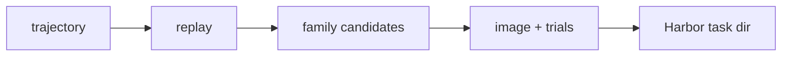

**Status:** experimental implementation
**Author:** @younesbelkada
**Created:** 2026-11-06

## Summary

Turn recorded coding-agent trajectories into Harbor tasks. A trajectory is replayed
over a virtual filesystem, task families mine candidates from it (a fixed check, a
project build, a follow-up feature, a data question), and a candidate is kept only
if its trial matrix passes offline in Docker. It is a native pipeline: it runs on
a Docker worker (local or `DOCKER_HOST`), and its `repair` family needs no LLM.

## Motivation

Every existing generator starts from a repository, a PR, a seed or a recording.
Agent trajectories are a different source: they record real requests, real failures
and the fixes that worked, across projects that often never reach a public
repository. Harnesses (Claude Code, Codex, pi) produce them in volume, and ATIF gives
them a common schema.

The anti-argument: `terminalworld` already reconstructs tasks from terminal
recordings, so trajectories could be another recipe input. They differ in shape and
infrastructure. A trajectory carries structured tool calls and file contents, so the
starting state is rebuilt deterministically rather than inferred by a model, and
generation needs only local Docker. Owned recipes require a remote worker and a
campaign ledger, which would make the LLM-free `repair` family pay for
infrastructure it doesn't use.

## Design

### Input

- **Source:** a new typed source, `{kind: trajectory, path, format}`. `format` is
  `atif` (default), `claude-code`, `codex` or `pi`; session logs are converted to
  ATIF-v1.7 before use. Local paths only.
- **Trigger:** `repo2rlenv generate --config <file>` with
  `pipeline.name: trajectory_to_env`. `GenerationInput` accepts a trajectory source
  with the native recipe; `generate` skips the repository-only preflight when no
  repository is set.
- **Options model:** `TrajectoryOptions`: `families` (default `[repair]`), `limit`,
  `jobs`, `scan`, `propose_only`, `platform`.

### Algorithm

1. Find ATIF files under `path`, or convert session logs.
2. Optionally screen each trajectory with atif-scan; blocking findings drop it.
3. Replay it over a virtual filesystem.
4. For each family: find candidates, prepare them (cheap checks plus at most one
   cached LLM call), build the image, check in the image, write the task files and
   run the trial matrix. Any step can drop the candidate with a recorded reason.
5. Add `[metadata.repo2env]` to each kept task and write `report.json`.

### Output

- **Task shape:** `instruction.md`, `task.toml`, `environment/Dockerfile`,
  `tests/test.sh` (plus family files) and `solution/solve.sh`. There is no
  `patch.diff`: `solve.sh` restores the reference files.
- **`[metadata.repo2env]` provenance:** `pipeline`, `recipe = "trajectory_replay"`,
  `reward_kinds = ["test_execution"]`, `reproducibility.mode = "inline_dockerfile"`,
  `family` and `source_trace`. `[metadata]` keeps `source_model` and family fields.

## Verification

- **Reward kind:** `test_execution`.
- **Reward formula:** `repair` is binary on the recorded check. `build` is the
  fraction of hidden tests passed. `extend` is the fraction of new tests passed, or 0
  if an existing test fails. `qa` is binary from a deterministic grader.
- **Oracle invariant:** every kept task passed a trial where the reference scored
  exactly full reward, inside the task's own image, offline.
- **Non-tamper:** use the shared native separate verifier. Only the project
  submission (or QA answer file) crosses from the stopped agent. Project grading
  rebuilds source against the pristine image, restores test configuration and
  uses an unprivileged test runner. Supported assertions receive contradictory
  test controls to detect in-process result forgery. This is bounded detection,
  not a guarantee against all malicious code. No-op and tampering controls must
  score zero; grader infrastructure failures remain ungraded.

## Anti-contamination

- **Leak paths:** a trajectory's own later steps contain the answer, so task
  instructions are built from the user's requests and the failing output, never
  from the fix. Package registries
  can serve newer code, so `repair` pins npm to the trajectory's date and `qa` pins
  inputs to the dataset commit at that date.
- **Guards:** project images retain only a fresh synthetic base commit, with no
  upstream history. Harbor's explicit no-network policy applies to execution.
  QA fetches pinned inputs during image construction, before that boundary.
- **Benchmark material:** the atif-scan gate drops trajectories that saw benchmark
  material or tampered with grading.

## LLM use

`at synthesis`, for `build`, `extend` and `qa`: one structured-output call per
candidate through the shared LiteLLM client, cached on disk by model, schema and
prompt. `repair` makes no calls. Cost hasn't been measured in Repo2RLEnv yet; it
scales with the number of `build`, `extend` and `qa` candidates, not emitted tasks.

## Yield & repo suitability

- **Expected yield:** a local smoke run on 40 Codex trajectories (`repair`) gave 3
  candidates and 2 tasks. Yield depends mostly on how often agents run a check that
  fails and then passes.
- **What works:** trajectories from Python or Node projects that run tests or builds
  in a shell, with file contents visible to the replay.
- **What doesn't:** trajectories whose files were never read or written in full
  (the replay marks them lost), fixes made by installing packages rather than editing
  code, and Windows paths.

## Dependencies

- **Reused machinery:** `PipelineResult`, the shared LLM client, `validate`, `push`,
  native source reconstruction, configuration guards, unprivileged launcher and
  contradictory-assertion verifier.
- **New code:** `pipelines/trajectory/`.
- **New external deps:** none. atif-scan is optional at runtime.

## Alternatives considered

- **Owned recipe.** Rejected for now: recipes require remote execution, and this
  pipeline's checks are cheap and local.
- **Emitting through `HarborTask`.** Rejected: families write their own task files
  and verify them before writing; routing through `HarborTask` would assume a
  `patch.diff` oracle these tasks don't have.
- **One task per trajectory.** Rejected: a trajectory often yields several
  independent repair or extend candidates.

## Rollout plan

1. **Smoke:** done on local Codex trajectories (`repair`).
2. **Scale:** generate a collection across harnesses and all four families.
3. **Oracle gate:** `harbor run -a oracle --env docker` on every task.
4. **Real-agent eval:** stratified sample with a reference agent.
5. **Publish:** private HF Hub dataset until trace licensing is cleared.
6. **Docs:** results in `docs/pipelines/trajectory_to_env.md`.
7. **Ship experimental**, then promote if quality holds.

## Open questions

- Should `hf://datasets/...` trajectory paths be supported directly?
- How much task diversity survives the construction controls across harnesses?
- Which blind rollout sample is sufficient to promote the generated `unverified`
  labels through the repository's quality loop?

## References

- [atif-scan](https://github.com/huggingface/atif-scan): the optional trajectory gate.
- [SmolDataEnvs](https://huggingface.co/datasets/FineEnvs/SmolDataEnvs-harbor-train) (MIT): origin of the `qa` grader.
- [RFC 0019](0019-terminalworld-recipe.md): the closest existing source, terminal recordings.

## Implementation

| | |
|---|---|
| **Initial PR** | [#237](https://github.com/huggingface/Repo2RLEnv/pull/237) |
| **Shipping release** | unreleased |
| **Source file** | `src/repo2rlenv/pipelines/trajectory/` |
| **Options model** | [`src/repo2rlenv/spec/options.py`](https://github.com/huggingface/Repo2RLEnv/blob/main/src/repo2rlenv/spec/options.py) (`TrajectoryOptions`) |
| **Doc page** | [`docs/pipelines/trajectory_to_env.md`](../pipelines/trajectory_to_env.md) |
| **Reference dataset** | none yet |
