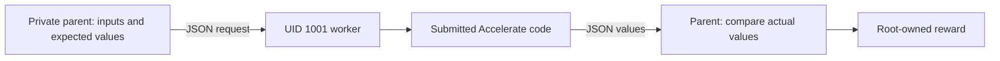

# Assertions outside submitted Python

This worked example migrates **HF ML Tasksmith `3d762a2acfee`**, the Accelerate
concatenation task, to a verifier that checks returned values in a trusted parent.
It does not convert arbitrary repository tests or update a published dataset.

```bash
python examples/tutorials/verifier-isolation/migrate.py \
  ./tasks/tasksmith-3d762a2acfee ./workspace/concatenate-isolated
```

Run the command from an installed Repo2RLEnv checkout. It only copies files.
Build and validate the new Harbor directory remotely. The original task, oracle
and historical evidence remain available; the new revision needs its own checks.



`value_worker.py` translates tensors and nested data to JSON. It is untrusted:
returning `{"passed": true}` proves nothing. `grade.py` checks scalar passthrough,
tensor contents, dimensions, nested containers, invalid mixed batches and a
data-loader integration. Challenge values vary, while the reward rule remains
deterministic for correct behavior. The reference patch is unchanged.

The reusable `isolated_call.py` primitive runs in a **dedicated, single-threaded
Linux root verifier**, with a reserved UID, root-only assertions and an outer
network-disabled sandbox. It drops supplementary groups, disables privilege
escalation, bounds output and time, and terminates worker descendants before
parsing JSON. Its purpose is process separation, not correctness scoring.

This is a new observable-value contract, not a promise of identical coverage to
the old pytest suite. In particular, JSON cannot establish arbitrary Python object
identity. The worker may still compute correct outputs by another method, and
finite tests cannot prove all behavior. Keep task-specific coverage and valid
alternative checks alongside report-forgery probes. No shared pytest export is
automatically marked repaired by adding this helper.

The example uses Repo2RLEnv's existing Tasksmith export as its input. The source
repository is [Hugging Face Accelerate](https://github.com/huggingface/accelerate),
under its own Apache-2.0 license. No Accelerate source or generated task data is
vendored here. See [the reviewer guide](../../../docs/pipelines/evidence_review.md)
for the audit scope and validation results.
